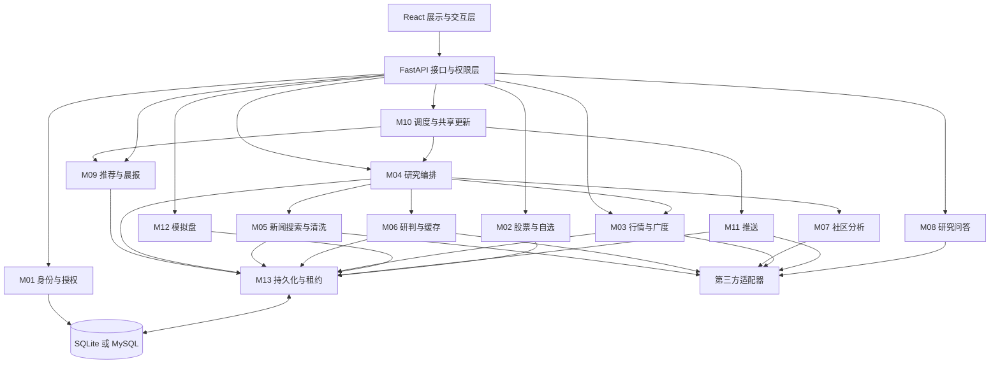
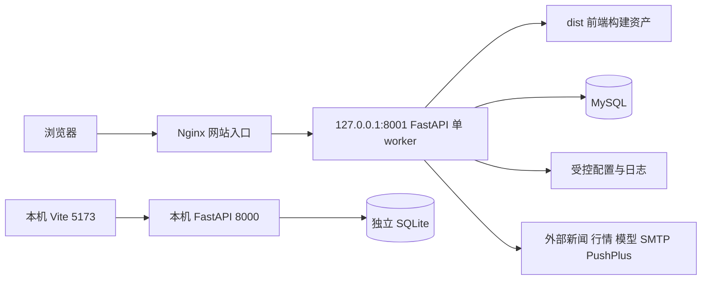
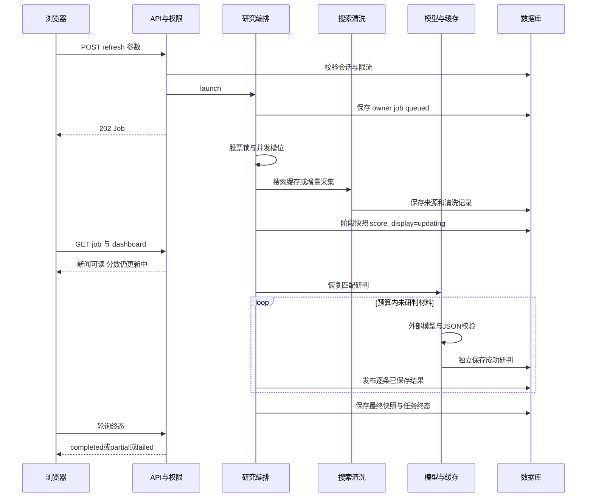
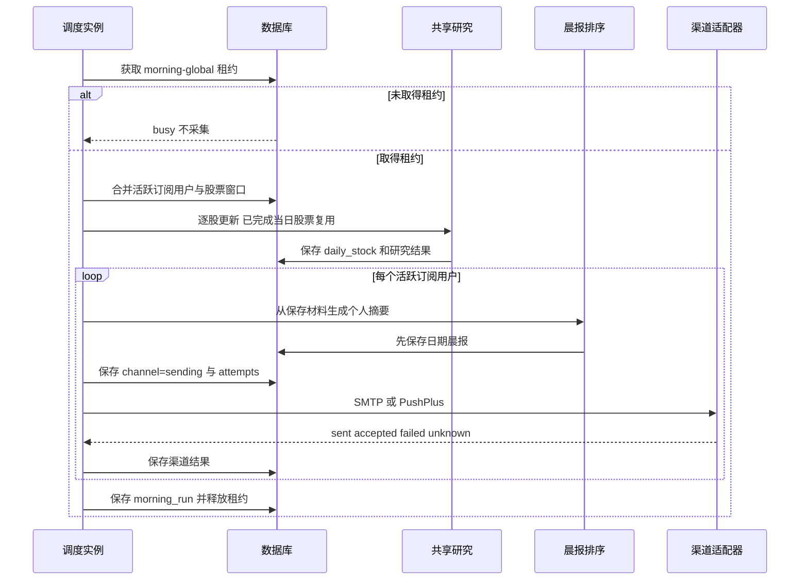
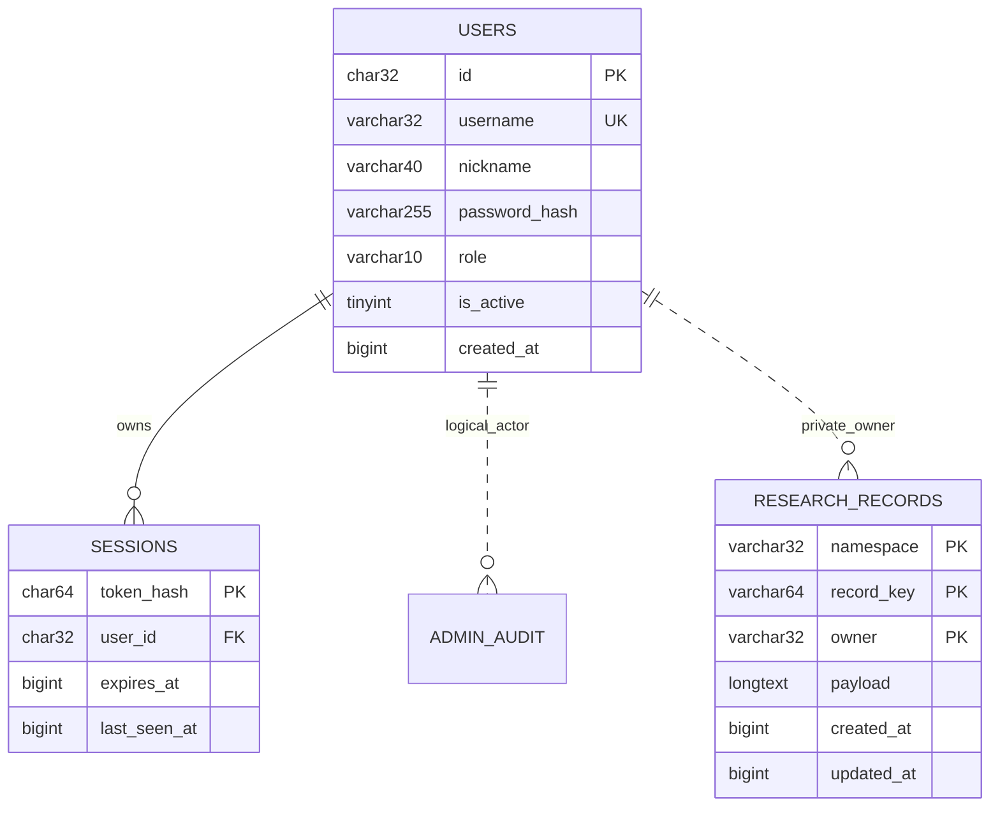

# FinPulse 股票信息研究平台软件设计文档

软件工程实践课程个人实验　版本 1.0　日期 2026 年 10 月 12 日

本设计以可追溯的股票信息研究为目标，说明如何将用户身份、公开材料、结构化研判、行情展示和个人订阅组织为一个可实现、可验证的系统。采用模块化单体与共享数据库，在小规模运行条件下控制外部调用成本、保持个人数据隔离，并明确并发、重启和外部服务失败时的处理边界。

本稿依据实验 1 需求分析文档和当前代码形成。已有机制、拟补充机制和验收目标分别标识，不能将本文中的设计方案或目标视为已完成实现或已通过验收。本次编写只进行静态核对，没有重新执行应用测试、压测或真实消息发送。

## 1 文档目的与需求基线

### 1.1 来源与版本

需求基线为仓库根目录“张鸿瑞_需求分析报告_v1.4.zip”中的“张鸿瑞/01_需求分析文档.md”，版本 1.4，日期 2026 年 10 月 10 日。该文档使用代码提交 70cbc538bbc5f0abc40697f8e640ec5e41afaea7 作为实施证据基线；本设计核对的当前提交为 eacc1e5bdded17277cfef54f954485f76134dd83。后一提交新增顶栏 GitHub 链接，不能由此推导其他未验证能力。

原需求编号 FR01–FR20、NF01–NF11、BR01–BR07、AC01–AC20、X01、X02a、X02b、X03、X04 原样沿用。本文新增的 M、P、I、D、UI、F、ADR、V、G 编号仅表示设计模块、流程、接口、数据、界面、故障、决策、验证和实施差距，不替代原需求编号。需求正文以基线为准，本文的概括不改变输入限制和验收口径。

原文“已有实现”表示找到实现证据，不等于真实运行环境全面通过；原 NF01、NF06、NF10、NF11 的量化数字保留为待验收目标。实验 1 的先验模拟数据不作为本设计的性能或质量实测结果。

### 1.2 状态标识与阅读规则

| 标识 | 定义 | 使用原则 |
| --- | --- | --- |
| C 当前实现 | 在本次代码核对中找到对应机制 | 只说明代码存在，证据范围见第 13 节 |
| P 拟补充设计 | 为落实原需求或解决技术缺口提出，当前尚未完成 | 实施前建立测试和兼容检查，不冒充现有接口 |
| T 待验收目标 | 沿用需求或提出设计验证目标，未取得本轮实测 | 报告样本、环境、分母和结果后才判断通过 |

正文同时描述现状与方案时分别使用 C、P 标识。未标识的业务取值和约束沿用基线；章节中的实现建议均不意味着本次修改了产品代码。

### 1.3 功能与非功能需求编号对照

| 原编号 | 名称 | 优先级 | 设计关注点 |
| --- | --- | --- | --- |
| FR01 | 账号与持续会话 | 高 | 注册、登录、退出、改密、固定 7 天会话 |
| FR02 | 管理员权限 | 高 | 后端角色校验、用户启停、审计 |
| FR03 | 股票检索与自选 | 高 | 沪深 A 股、账号隔离、最多 20 只 |
| FR04 | 行情及周期切换 | 高 | 行情独立，日周与五种分钟周期 |
| FR05 | 公司与行业新闻采集 | 高 | 日期窗口、来源、预算、部分失败 |
| FR06 | 新闻清洗及去重 | 高 | 主体与日期核验、事件去重、原因 |
| FR07 | 时间范围复用与增量搜索 | 高 | 3600 秒边界、长覆盖短、增量游标 |
| FR08 | 结构化 AI 研判 | 高 | 非零 ±100、5 分步长、证据字段 |
| FR09 | 已有研判的持久化复用 | 高 | 输入身份、版本、原时间、重启复用 |
| FR10 | 任务进度与全部研判 | 高 | 默认 6 条、全部待研判、逐条保存 |
| FR11 | 公司概览与分阶段展示 | 高 | 分数门控、7 天半衰期、日期标记 |
| FR12 | 社区样本分析 | 中 | 公开帖子、至少 5 条、ID 完整匹配 |
| FR13 | 可解释推荐排序 | 高 | 五类分项、去重、多样性、阅读优先级 |
| FR14 | 个人晨报与日期历史 | 高 | 个人偏好、预览、生成、日期历史 |
| FR15 | 每日共享更新与调度 | 高 | 上海时区、共同股票、租约、今日补做 |
| FR16 | 邮件与微信渠道推送 | 高 | 独立开关、渠道记录、重试、未知结果 |
| FR17 | 研究问答 | 中 | 已保存上下文、权限、资料不足 |
| FR18 | 审计与研究数据导出 | 高 | 来源、清洗、版本、JSON、秘密过滤 |
| FR19 | 模拟研究演练 | 低 | 20 万元、T+1、服务端报价、幂等 |
| FR20 | 大盘广度与事后价格观察 | 低 | 广度公式、3/5 交易日、缺失 |
| NF01–NF03 | 性能、多账号正确性、费用控制 | 高 | 延迟和成功率、隔离、调用计数 |
| NF04–NF05 | 故障恢复、安全隐私 | 高 | 状态与保留结果、权限与秘密 |
| NF06 | 易用性 | 中 | 两种视口、5 人任务验收 |
| NF07 | 可追溯性 | 高 | 来源、日期、模型、Prompt 和时间 |
| NF08 | 可维护与可复现 | 中 | 锁文件、构建、规则与验证编号 |
| NF09 | 时序与一致性 | 高 | 固定时钟、边界、未知日历 |
| NF10–NF11 | 备份恢复、材料与模型质量 | 中 | 恢复演练、人工标注和事实核查 |

### 1.4 范围与术语

访客可阅读公开材料；注册用户有独立私人配置；管理员管理普通账号和每日任务；运维维护者通过部署权限维护服务。管理员网页身份不等于数据库管理权限。轻量团队只共享公开研究成果，不包含组织空间、成员邀请或私人协作笔记。

候选材料指搜索返回的待核验内容；有效新闻指清洗后保留的事件材料；研判指对目标公司及特定材料生成的结构化判断；研究快照指可展示的某轮结果；晨报指按个人偏好从保存材料构建的摘要。单条方向分、公司综合分、推荐优先分和广度值是不同量，不能互换。

不实现真实证券委托、资金托管、收益保证、全网完整召回、秒级逐笔、北交所及港美股全覆盖。事后价格观察不作为因果证明或策略胜率。

## 2 设计目标与运行约束

### 2.1 目标

设计目标是支持“找到股票—阅读有效材料—核查依据—对照行情—持续订阅”的流程，并降低重复检索和分析成本。优先保证身份隔离、来源和日期正确、结果状态可解释，再优化加载速度。高优先级功能存在未关闭验收失败时，不将整体版本标为通过。

### 2.2 约束与假设

| 编号 | 约束或假设 | 对设计的影响及检验 |
| --- | --- | --- |
| A01 | 当前服务器一个 FastAPI worker | 进程内锁有效；不能直接加 worker 扩容研究写入 |
| A02 | B1 拟用 2 vCPU、4 GB，单 worker，数据库同机或内网，20 活跃账号 | 这是测试基准，不是服务器硬件事实；按 NF01 测量 |
| A03 | 外部来源可能限流、缺数据、改格式 | 适配层隔离；保留来源和降级状态 |
| A04 | 兼容模型接口不保证各服务商完全相同 | 校验响应、记录配置与实际模型标识；不假设稳定输出 |
| A05 | 公开材料共享，私有记录不共享 | owner 从会话生成，客户端不能指定 |
| A06 | 原时间窗口是上海日期闭区间 [D−N,D] | N=7 覆盖 8 个日期标签，不能偷偷改成 168 小时 |
| A07 | 调度每天或周一至周五 | 不等于仅交易日；X02b 另行设计 |
| A08 | 单次搜索结果数量有限 | 缓存命中不证明完整召回，空结果不证明不存在事件 |

运行密钥保存在服务端受控配置中，不提交到 Git、不置于静态目录。Web 网络可达、模型已配置、数据库可用、消息受理和消息真实送达分别判定。

## 3 总体架构与部署运行设计

### 3.1 组件分层

图 1 中实线箭头表示调用，双向箭头表示经存储接口读写；同一框内的业务组件目前位于一个后端进程中。逻辑组件不是独立部署服务。



前端负责视图、用户选择、图表指标和展示门控，不决定权限或成交价。接口层解析请求并校验身份，将业务交给模块；业务层编排规则；适配层转化外部格式；持久化层隐藏 SQLite/MySQL 差异。具体依赖见第 4 节，存储归属见第 7 节。

C：ResearchService 实际承载编排、社区分类、快照发布等职责。图中将其分解为 M04/M07 等逻辑职责，不能声称代码已拆成独立类。P：先提取无状态计算和 payload 校验，再按稳定接口拆分类，保持现有路由兼容；不先拆微服务。

### 3.2 部署视图



C：部署文件采用 systemd 管理后端、Nginx 转发入口，后端只暴露构建资源；开发模式 Vite 将 /api 代理到 8000。共享 MySQL 开发是另一种配置选择，不是本机必需。生产和开发环境同时运行时，各自数据库和调度权限必须明确；只有指定调度实例启用每日工作。

P/T：广域发布前配置 HTTPS、Secure Cookie、反向代理受信来源和受控域名；限制数据库访问，配置备份与恢复演练。当前校园网络或隧道可访问不等于 X03 已关闭。部署顺序为备份、安装固定依赖、构建、数据库兼容检查、停旧服务切换、启动、健康与权限冒烟；失败回退代码和可兼容数据库版本，不自动逆向覆盖新数据。

### 3.3 运行视图与并发边界

C：应用 lifespan 初始化数据库、研究、行情、模拟盘、晨报和调度对象；关闭时取消并等待后台工作。外部异步 HTTP 不阻塞事件循环；阻塞数据库或 SMTP 放入线程；部分 AkShare 工作使用可终止子进程限制等待。

C：研究工作并发 2，同股票锁串行保护共享研究写入；模型并发 4，获取槽位等待上限 30 秒；研究活动任务上限 40，超过返回 429。锁等待先于占用研究槽位，避免同股票排队挤占所有执行能力。研究总执行上限 1800 秒。模型请求 90 秒、连接 10 秒；AkShare 单次子进程 45 秒，重试会增加总耗时。这些是不同层次的限制，不能相加后视为 NF01 缓存响应承诺。

C：同用户同股票已有活动任务时返回已有 job，即使新参数不同；不同账号仅在 code、days、maximum、community、community_only、analysis_only 相同的情况下共享编排工作。参数不同的工作按股票串行，仍可共享搜索和研判缓存。

P：新请求与已有任务参数不一致时明确返回 409 ACTIVE_JOB_CONFLICT，并携带 active_job_id；相同参数继续复用。该错误为拟补充契约，当前接口没有此行为。这样落实 FR10 参数与进度对应关系，不增加新的研究功能。

## 4 模块设计

### 4.1 模块边界与内部结构

| 模块 | 职责与内部结构 | 主要依赖 | 数据及原需求 |
| --- | --- | --- | --- |
| M01 身份授权 | AuthStore、会话、密码、来源/CSRF、角色、限流 | 数据库连接 | D01–D04；FR01/02，NF05 |
| M02 股票自选 | StockCatalog、列表缓存、拼音匹配、自选写锁 | M01、M13、股票适配器 | D05/D06；FR03 |
| M03 行情广度 | DailyMarket、MinuteMarket、Bundle、交易日历、广度历史 | M02、M13、行情适配器 | D07；FR04/20 |
| M04 研究编排 | launch、活动任务、共享执行、collect、快照发布 | M02/03/05/06/07/13 | D08/D11/D12；FR05/10/11 |
| M05 搜索清洗 | NewsSearch、Extract 缓存、公司/行业查询、clean_report | M13、来源适配器 | D08/D09；FR05/06/07/18 |
| M06 研判缓存 | 上下文身份、Prompt、completion、JSON 校验、保存恢复 | M13、模型适配器 | D10；FR08/09 |
| M07 社区分析 | 直采与备用、帖子核验、ID 分类、加权比例 | M06 的调用能力、M13 | D13；FR12 |
| M08 研究问答 | 保存材料上下文、历史消息输入、响应校验 | M01、M04、模型适配器 | 临时会话；FR17 |
| M09 推荐晨报 | 规则排序、事件去重、多样性、HTML、日期存档 | M13、M02 | D14；FR13/14 |
| M10 每日调度 | 日任务、共同股票合并、租约续期、今日补做 | M04/09/11/13 | D16/D17；FR15 |
| M11 渠道推送 | SMTP、PushPlus、受理状态、次数与重试 | M01、M13、渠道适配器 | D15；FR16 |
| M12 模拟盘 | 报价核验、交易规则、资金与持仓、幂等成交 | M02/03/13 | D18/D19；FR19 |
| M13 持久化 | JSON 文档、批量读取、事务、持久租约 | AuthStore 连接适配 | 所有研究记录；NF02/04/07/09 |
| UI 前端 | AuthContext、App、图表、新闻、晨报、管理与模拟盘 | HTTP API | UI01–UI06；NF06 |

M06 不承担新闻检索；M09 只基于已保存材料生成晨报，不隐式启动采集；M11 不修改研判结果；M12 的成交过程不调用外部网络。M13 不判断利好利空，业务规则由调用模块校验。技术指标如 MA、EMA、BOLL、MACD、RSI 的显示计算目前在前端数学模块，不能照搬早期方案声称全部在后端。

### 4.2 三个重点模块

M04 的内部执行顺序为任务受理、等待股票锁、获取研究槽位、并行数据准备、清洗与阶段发布、恢复研判、分析并逐条保存、最终发布及任务终态。任务记录私人，材料公开；“正在更新”和“已完成”来自同一轮状态，不能靠读取旧快照推断。

M05 将公司、行业和 AkShare 来源分别记状态。新闻网页是数据，不执行其中指令；正文提取失败可以使用片段，但必须标记质量。清洗使用链接、日期、主体、标题和事件特征判断；不同金额或公告编号不因标题相似而合并。原始候选和清洗记录独立保存用于审计。

M10 先合并已启用晨报的活跃用户自选股，使用足以覆盖各用户偏好的窗口采集；再为每人生成并保存报告；最后逐渠道发送。共享采集不共享个人偏好或收件信息。持久租约负责防止同一日调度争抢，不能据此推导普通研究任务自动恢复。

## 5 关键流程与状态设计

### 5.1 P01 新增自选并启动研究

用户提交 I02 add → M01 校验会话、来源和 CSRF → M02 核验股票、重复、20 只上限和限流 → 锁定用户自选写入 → M04 保存 queued job，保持执行门关闭 → 保存自选列表 → 打开执行门 → 返回 202。

重复添加返回 added=false 及已有活动任务，不新增自选。股票未核验返回 422；队列满返回 429。C：自选保存失败则取消 gated task，任务标记失败；两次写入不是单一事务。P：G03 使用同一事务保存 job 与自选，提交后才建任务；提交后启动失败标记 job failed，自选保留并允许用户重试，不偷偷触发付费工作。

### 5.2 P02 采集清洗与结构化研判



行情独立由 M03 加载，任务内行情更新也可先发布。搜索部分失败继续使用可用来源及范围内旧材料，标 stale 和 warnings；全部失败且无旧材料显示不可用。模型坏 JSON 允许一次格式纠正，仍失败时该条保持待研判并记录原因，不以 0 分补齐。预算默认 6 条，复用不占预算。全部研判入口只处理保存的待研判条目，不重新搜索。

若研判已持久化而快照更新失败，该研判仍可在下一次恢复；任务失败不能抹去它。P：将可展示失败与分析失败分开记 F05，重试先恢复 D10，再重建快照，避免重复模型费。未经持久化成功的响应不能称为“已保存”，数据库失联时不能假定写入成功。

### 5.3 P03 窗口切换与缓存决策

| 条件 | 搜索处理 | 研判处理 |
| --- | --- | --- |
| 同身份、原成功时间距今 3599 秒 | 裁剪当前窗口，来源请求 0 | 独立校验输入身份，匹配则模型请求 0 |
| 距今达到 3600 秒 | 从原游标至本轮请求开始补搜，合并窗口内旧材料 | 仅依据变化的条目重算 |
| 30 天改 7 天，覆盖与时效符合 | 派生独立短缓存，不修改长缓存和成功时间 | 原材料保持稳定，恢复原时间 |
| 7 天改 30 天，缺历史 | 完整取得缺失覆盖，不以短缓存宣称满足 | 已匹配部分仍可复用 |
| 跨午夜仍在一小时内 | 用新 D 重算 [D−N,D] 并裁剪 | 不因日历变化重算同一材料 |
| 来源部分失败或失败 | 不推进游标；保留合规旧材料，下次补搜未完成间隔 | 不以 stale 状态变化本身废弃未变事实 |

T：跨午夜的一小时内复用只表示上次取得的集合，不保证新一天事件已覆盖。仅日期的外部结果不能伪造成午夜时间；接口按日查询，具备时间戳的候选再过滤到实际间隔。游标取请求开始时间，避免慢请求期间新发布事件被跳过。

### 5.4 P04 并发参数与任务结果归属

C：A 请求 30 天含社区、B 请求 7 天不含社区时，工作参数不同，不共享整轮执行；股票锁使两轮串行。搜索缓存和研判缓存可以复用。dashboard/code 是最近一次快照，后完成者会替换它；job 的 data_revision 指向共享看板当前版本，不是不可变的私人结果。因此当前用户可能在任务结束后读到另一轮快照，这属于 G01 实施缺口。

P：每次整轮执行生成 run_id；每次发布另生成 revision，并保存不可变 snapshot。私人 job 保存 request、run_id、data_revision、result_snapshot_id。相同参数的不同账号任务绑定同一 run_id，私人进度和授权仍分开。不同参数任务各自绑定结果。最终写入事务先插入 snapshot，再更新公开 dashboard 引用和关联 job 终态；提交前都不宣称完成。

P：新增 I04 GET job/result，仅查询本人 job 再解析结果；不存在终态结果返回 409 RESULT_NOT_READY。前端最终结果从该接口读取，公开 dashboard 仍是最新公开视图，必须显示窗口和更新时间。行情可单独刷新，但不修改结果中的原始分析依据；展示时分别注明行情时间与研究时间。

P：事务更新只针对该 run 的关联任务，不覆盖已取消观察者的私人状态。客户端取消轮询不取消共享工作；登出清理本地展示。普通研究的执行中去重目前是进程内能力，多 worker 研究发布在 G01 完成之前不支持。

### 5.5 P05 每日晨报和渠道发送



C：全局租约默认 600 秒，每 60 秒续期；续期失败停止本轮，避免继续与新持有者重叠。重启检查今日已到期任务，复用今日已完成股票，不补历史日期。正常重跑不重写已有日期报告；手动执行可重新生成。每渠道发送有 120 秒租约，明确失败 900 秒后可重试，最多 3 次；缺配置不消耗次数。

C：sending、unknown、sent、accepted 不自动重复发送。sending 时崩溃仍可能已经送达，重启不能当作明确失败。FR16 要求提示人工检查；P：UI05 显式说明待核查且无自动重发，人工再次发送必须显示可能重复，并生成独立测试记录，不复用已成功日渠道键。保存订阅或预览绝不发送。

G05：generate 当前先写日期报告，再写 latest，不是原子。P：在一个事务中保存两者；恢复扫描日期记录重建 latest，可避免最新入口落后而丢失已生成报告。渠道成功只能证明受理，真实收件另验收 AC16-04/05。

### 5.6 P06 社区与问答

社区先直采公开列表与详情，核验目标股票、独立帖子及原始日期；不足或失败再尝试 Tavily。少于 5 条不调用分类模型，不生成比例。模型返回 ID 集合必须与输入完全相同且无重复。C：每帖权重为 1+ln(views+1)+2ln(replies+1)，缺互动量取 0；按各类权重和计算比例。看多>85%或看空>80%只提示样本集中，不推断反转。加权是设计细化，不把有限样本包装为总体民意。

问答仅使用当前保存材料与用户输入，未取得资料明确说明。前端会话不持久化；退出或换账号清空。服务拒绝未登录、停用及 CSRF 错误请求，然后调用模型。手工材料分析 /api/analyze 明确未经平台来源核验，不能自动混入公开可信新闻集合。

### 5.7 P07 模拟成交与价格观察

客户端提交 UUID、代码、方向和数量，不提交成交价。服务锁定用户行，检查已有 request_id：相同 intent 返回原成交，不同 intent 返回 409。新成交在事务内读取当前服务端分钟缓存，再核验交易时段、日历、报价、数量、资金和可卖持仓。现金与持仓及不可变成交记录一次提交，任一步失败回滚。外部行情请求在事务之外。

C：资金用整数分，初始 20,000,000 分；主板/创业板买入最低 100 且整百，科创板最低 200 且步长 1；卖出零股另按板块规则。连续交易按本版 09:30–11:30、13:00–14:57 约束，未知日历拒绝。报价日期须与当前上海日期一致，分钟时间距当前在−60至180秒内，采集时间距当前在0至90秒内；OHLC有限且正、成交量非负。手续费采用代码中的模拟规则，属于学习参数，不将其宣称为所有券商实时收费。

价格观察按发布日之后首个交易日收盘为基准，再取其后第 3、5 个交易日收盘；不够则 null，不使用自然日补齐。未复权且不含费用。广度值=(上涨+0.5×平盘)/总家数×100，身份或字段无法核验则不可用，不改称综合恐惧贪婪指数。

### 5.8 状态机与恢复

| 对象 | 当前状态与转换 | 中断语义 |
| --- | --- | --- |
| 研究 job | queued→running→completed/partial/failed | C：优雅关闭尽力标 failed；强制退出可能遗留 running；不会自动续做 |
| 新闻研判 | pending→completed 或带 analysis_error 的待研判 | 成功 D10 保留，未成功不补分 |
| 展示门控 | updating→ready | 当前轮结束前不把旧分数当新完成分数 |
| 日更新 | queued/running→completed/partial/failed/interrupted | 当日重启可继续，已完成股票复用 |
| 渠道 | 待处理→sending→sent/accepted/failed/unknown/not_configured | 明确失败受限重试；未知与 sending 人工检查 |

P G02：job 新增 executor_instance_id，实例启动时将属于本实例前一次启动、仍 queued/running 的普通 job 标 failed，理由为进程中断；不把别的存活实例任务批量失败。实例标识绑定部署实例，不使用每次随机值无法定位旧任务。保留研判，用户重发。若以后多实例工作，需增加心跳和租约 fencing，再讨论续做。

## 6 接口与调用契约设计

### 6.1 I00 公共约定

UTF-8 JSON，股票代码为六位字符串，不转整数。新闻日期 YYYY-MM-DD；业务时间戳 ISO 8601 带偏移，研究统一上海时区；账号接口可能返回 UTC 带偏移，前端转换而不丢时区。缺失用 null 或明确状态，不用 0 代替未知分数或价格。

GET 私人记录需会话；受保护 POST 需会话、合法来源及 X-CSRF-Token，owner 不接收客户端值。注册/登录没有已有 CSRF，但必须通过来源检查。Cookie 为 finpulse_session，HttpOnly、SameSite=Strict、路径 /api；公网配置 Secure。私人响应 Cache-Control:no-store。

C：错误不完全统一。AuthError、PaperError 返回 {detail:string,code:string}；HTTPException 通常 {detail:string}；参数错误返回 {detail:[{loc,msg,type}]} 且不回显密码。客户端兼容这三种形式，不能假设所有接口已有 code。

| HTTP | 语义 | 客户端行为 |
| --- | --- | --- |
| 200/201 | 读取、完成同步动作或注册 | 仍检查业务 status；200 不代表所有来源成功 |
| 202 | 已受理异步任务 | 用返回 id 轮询，不当作完成 |
| 401/403 | 未认证、停用、越权、来源/CSRF 错误 | 重新认证或提示权限，禁止自动循环提交 |
| 404 | 股票、本人任务或新闻不存在 | 重新检索；他人任务与不存在使用同类响应 |
| 409 | 模拟规则或幂等冲突；拟补充任务冲突 | 展示业务原因，不直接重试 |
| 422 | 输入不符合规则 | 指定字段或操作原因，用户修正 |
| 429 | 限流或队列容量耗尽 | 有 Retry-After 时遵守；否则退避，不承诺所有 429 均有该头 |
| 502/503/504 | 上游无效或失败、数据库不可用、调用超时 | 保留可用界面；非幂等付费动作不盲重试 |

P：统一错误结构拟增加 code、request_id、retryable，并保留 detail 的旧类型；鉴权和模拟现有 code 不重命名，新增码有清单。不将内部异常、上游响应原文、密钥或 SMTP 信息返回给用户。

### 6.2 浏览器接口目录

表中 I 编号为本文接口组编号，不是路由路径。输出字段详细结构见 D 编号与 6.3 示例；未列字段不视为强制新字段。

| 组 | 方法与路径 | 输入与输出 | 权限及限制 |
| --- | --- | --- | --- |
| I01 | POST /api/auth/register；/login；/admin/login；/password；/logout；GET /me | 注册 username 3–32、nickname 1–40、password 8–128；登录密码 1–128；改密 current_password/new_password；返回 user、csrf_token、expires_at 或动作结果 | 注册 201，其他成功 200；固定 7 天；username 按原正则且不区分大小写；改密需认证和 CSRF |
| I01A | GET /api/admin/users、/audit；POST /api/admin/users/{user_id}/status | 用户列表/审计；写 {is_active:boolean} | 管理角色，写需 CSRF；角色由服务端判定 |
| I02 | GET /api/stocks；GET/POST /api/watchlist；POST /api/watchlist/add | q≤80、codes≤160、limit 1–50 默认30；保存 {codes:string[]}；新增 {code}→{codes,stock,added,job} | 搜索公开；自选需认证；≤20且无重复；新增202 |
| I03 | GET /api/market/{code}/bundle、/daily、/minutes；/api/market/sentiment、/history；/api/dashboard/{code} | refresh 默认false；bundle wait 默认true；minutes period∈{1,5,15,30,60}默认1；返回 D07/D11 与状态 | 公开；参数不合法422，未知股票404；bundle 冷源可能等待，前端优先 wait=false |
| I04 | POST /api/research/{code}/refresh、/community、/analyze-all；GET /api/research/jobs/{job_id} | refresh {days:30,max_articles:6,include_community:false}；days1–90、预算1–8；community {days:30}；analyze-all {}；返回 D12 | 提交202；本人查询；研究类每账号每15分钟12次，上限40活动任务 |
| I05 | POST /api/news/{code}/{news_id}/analyze；POST /api/chat；POST /api/analyze | 单条无业务体；chat {messages,stock_code?}，1–24消息，每条1–10000字符，role user/assistant；手工分析 title≤300、content≤12000、stock_name≤50；输出模型响应与研判 | 认证和CSRF；单条每15分钟30次；模型全局并发4 |
| I06 | GET /api/research/{code}/audit；研究JSON导出 | audit返回清洗 items、summary、date_range；导出由前端序列化已取得快照 | audit需认证；C：无独立export路由；禁止原样附订阅和密钥 |
| I07 | GET /api/briefing/preview、/history、/latest、/history/{date}；POST /generate | preview/generate返回D14；latest {digest:null或D14}；history {items:[date,generated_at,count]}；历史日期YYYY-MM-DD | 认证；generate每15分钟30次；历史最多返回100日期；预览和生成不采集不推送 |
| I08 | GET/POST /api/subscription；POST /api/briefing/test-delivery | D14偏好与D15状态；token缺省/null保留、空字符串清除；测试返回过滤渠道结果 | 认证与写CSRF；测试每15分钟5次，无渠道422；保存不发送 |
| I09 | GET /api/admin/briefing/status；POST /settings、/run | settings {enabled:true,morning_time:"08:30",every_day:true,lookback_days:7,max_articles:6}；run返回日任务 | 管理员；run202，每15分钟6次；实际scheduler基础配置预算可能为3，设置接口默认6，文档分别说明 |
| I10 | GET /api/paper/account、/quote/{code}、/trades；POST /trades | GET trades limit1–100默认20、before_seq正整数；POST {request_id:UUID,code,side:buy或sell,quantity:严格正整数≤1000000}→D19 | 认证，写CSRF；服务按板块进一步限制；幂等和规则冲突409或字段422 |
| I11 | GET /api/health | configured、model、provider、tavily_configured、scheduler_enabled等 | 公开；C：配置检查，不证明数据库/外部服务已连通 |

P I04R：GET /api/research/jobs/{job_id}/result，输出 {job_id,run_id,snapshot_id,snapshot}，权限本人，未就绪409，丢失结果503并记录一致性故障。Job 新字段兼容添加；旧终态 job 若无 snapshot_id，展示“旧版本任务无独立快照”，不得套用最近看板伪造旧任务结果。

订阅完整写入体为 {enabled:true,email:"",email_enabled:true,wechat_enabled:true,max_items:10,lookback_days:7,interests:[],pushplus_token:null}。max_items为3–20、lookback_days为1–30，interests只能取“业绩财报”“公司公告”“行业政策”“风险事件”，最多4项且不能重复；email最长254，非空须合法且无换行，token最长200。C：该POST是完整设置语义，未提供的非秘密字段恢复请求模型默认值，不是PATCH；秘密token仅缺省/null保留、空串清除。返回写入结果不回传token；读取返回pushplus_configured及过滤后的delivery，前端保存前应先加载现有偏好。

股票检索输出 {items:Stock[],total:int,data_source:"live",scope:string,sources:object,warnings:string[]}，total为库中股票总量而非本页匹配数。自选读取输出 {codes:string[],items:Stock[],jobs:Job[]}，其中jobs是当前用户活动任务，不是完整任务历史。bundle输出 {dashboard:Dashboard,minutes:{"1":MinuteView,"5":MinuteView,"15":MinuteView,"30":MinuteView,"60":MinuteView},status:"ok"或"partial",errors:object,next_poll_seconds:int,fetched_at:ISO时间}；每个周期有独立状态和candles，日线结果位于dashboard.candles。C：无统一success布尔字段，前端必须检查对应业务状态。

### 6.3 关键格式示例

以下为结构示例，数值与名称用于解释格式，不是实测新闻或用户记录。news 的完整字段见 7.3；新增字段均显式注明 P。

```json
{"days":7,"max_articles":6,"include_community":false}
```

```json
{"id":"32位任务标识","code":"600519","kind":"research",
 "status":"queued","stage":"等待处理","created_at":"2026-10-12T08:30:00+08:00",
 "warnings":[],"counts":{}}
```

```json
{"analysis":{"sentiment_score":5,"assessment":"positive","confidence":"low",
 "horizon":"short","summary":"结构示例中的小幅正向判断",
 "causal_chain":["材料事实","业务传导","净方向判断"],
 "uncertainty":"本示例没有真实来源，不作实际判断",
 "positive_factors":["示例条件"],"negative_factors":[],"watch_points":["核查条件"],
 "version":"news-v5-directional"},
 "model":"响应模型标识","prompt_version":"news-v5-directional",
 "analyzed_at":"2026-10-12T08:30:00+08:00","cached":false}
```

C：前端普通任务每 2 秒轮询一次；queued/running 继续，completed/partial/failed 停止。部分来源失败是 200 快照/终态 partial + warnings，不使用 HTTP 206。取回任务终态后读取结果；P 使用 I04R，C 仍读取共享 dashboard，需显示现状边界。参数额外字段在核心请求模型被拒绝，null 不等于使用默认值；订阅 token 的三态是明确例外。

### 6.4 内部模块接口

| 编号 | 签名与用途 | 输出及错误 | 调用条件 |
| --- | --- | --- | --- |
| II01 | ResearchService.launch(code,user,days=30,max_articles=6,community=False,start=True,community_only=False,analysis_only=False) | Job；容量HTTP429；保存失败异常 | user来自会话；返回前保存job |
| II02 | refresh_shared(code,days=7,maximum=3,community=False,progress=callback,community_only=False,analysis_only=False) | Dashboard；运行上限1800秒 | 参数相同共享；股票锁保护，不直接暴露给未认证请求 |
| II03 | NewsSearchService.search(identity,days,start,end,fetcher) | results、warnings、search_cache；ProviderError | fetcher(since,until)接受日期；租约保护缓存更新 |
| II04 | clean_report(raw_report,extracts,entities,industry_profile) | items、audit、summary | 无网络，原材料不执行，日期质量参与判定 |
| II05 | analyze_document(stock,item)；AnalysisCache.restore(stock,items,profile,business,model) | reply或恢复数量；结构失败502 | 调用前材料稳定；成功先写D10 |
| II06 | build_digest(store,owner,now=None)；MorningService.generate(owner) | Digest；generate保存日期与latest | build无隐式采集/发送；owner受控 |
| II07 | MorningService.run(manual=False,run_id=None)；deliver_digest(owner,digest,test=False) | 日任务/渠道记录或busy | 获取租约，发送前再检查用户活跃状态 |
| II08 | ResearchStore.get/put/get_many/list(namespace,key或keys,owner)；claim/renew/release | JSON记录、租约token/布尔 | namespace白名单由业务封装；不向浏览器提供任意查询 |
| II09 | PaperStore.transact(owner,request_id,intent,apply) | 成交；AuthError/PaperError | 单事务用户锁，apply无网络和外部副作用 |

P：为 D11 snapshot 增加 put_snapshot_and_finish(run,jobs,snapshot)，必须在一个事务中更新结果引用和终态，返回 revision。M04 不直接拼接 SQL，M13 不判断分析方向。新增 II10 reconcile_jobs(instance_id) 为 G02 启动恢复接口。

### 6.5 外部系统接口与限制

以下按当前适配器代码描述实际调用，不将第三方未承诺能力加入系统契约。外部可用性、额度和参数兼容性在联调时验证。

| 外部系统 | 调用格式与所需字段 | 超时与失败处理 |
| --- | --- | --- |
| 模型服务 | POST 配置base_url+/chat/completions；Bearer；model、messages、temperature=0.4、max_tokens、stream=false；取choices[0].message.content、model、usage | 90秒/连接10秒；4槽位、等待30秒；长度截断/格式失败有限纠正；上游401/403/404/429映射安全说明，不泄露响应原文 |
| Tavily Search | POST /search；Bearer；query、topic=news、search_depth=advanced、start_date/end_date、include_raw_content=true、include_answer=false；公司子查询max_results=12，行业8，公告查询限制域名 | HTTP55秒/连接10秒；单搜索包装95秒；部分子查询异常保留其他结果；备用密钥不代表无限额度 |
| Tavily Extract | POST /extract；urls，extract_depth=basic，format=text；取url/raw_content | 使用同HTTP限制；C本轮提取预算12个链接，缓存不占新提取预算；片段降级 |
| AkShare及行情备用源 | Python适配器按代码获取列表、日线、新闻或分钟；归一化 code/date/OHLC/volume | 子进程45秒，可终止并有限重试；源格式异常拒绝，缺分钟不补造 |
| 东方财富公开帖子 | HTTP读取列表/详情中的公开字段；帖子ID、目标代码、日期、正文、互动量 | 核验主体日期；少于5条不统计；源失败Tavily备用，不绕登录或验证码 |
| 公司主营与行业资料 | 按证券代码查询公开资料；核验返回代码与唯一记录；保留source/url/main_business | HTTP12秒；失败可保留已核验旧事实并标状态，不推断分部收入 |
| SMTP | 服务端配置host/port/username/password/from_email；收件地址、标题、HTML | 20秒；465使用TLS，其他配置STARTTLS；认证/拒收failed，结果不确定unknown |
| PushPlus | POST https://www.pushplus.plus/send；token/title/content/template=html | 20秒；HTTP成功且业务code=200记accepted；5xx或网络不确定记unknown；不保证收件 |

Tavily 公司查询含多个子查询，所以“搜索并发 2”是逻辑工作限制，不能声称外部 HTTP 全局只会并发 2。P：统一 HTTP 槽位与每源请求计数作为 G06 容量改进，初值需按配额与 B1 实测选择，不在文档中虚构服务商限额。受限来源不做无限重试。

## 7 数据模型与一致性设计

### 7.1 物理模型

C：账号采用关系表，研究数据采用通用 research_records。MySQL 为 InnoDB、utf8mb4，SQLite 使用 WAL 和短写事务。所有数据访问使用参数化 SQL。



实线用户会话有数据库外键；虚线 owner 与审计 actor 是逻辑关系，当前没有外键。owner=''表示公开或系统记录，私人owner为用户32位ID，不允许客户端输入空值绕过隔离。

| 数据编号 | 表或实体 | 关键字段及约束 |
| --- | --- | --- |
| D01 | users | id32位；username唯一且大小写不敏感，3–32；nickname1–40；password_hash只保存Argon2id；role user/admin，is_active0/1；时间Unix秒 |
| D02 | sessions | token_hash64位唯一，不存原令牌；user_id外键；created_at/expires_at/last_seen_at；有效期固定7天，恢复不延期；用户及过期索引 |
| D03 | auth_rate_limits | bucket64位唯一，window_start Unix秒，attempts非负；窗口900秒；同事务更新避免并发绕限流 |
| D04 | admin_audit | id32位、actor_id/name、target_name、action、created_at；保留操作历史，按时间索引 |
| D00 | research_records | (namespace,record_key,owner)复合主键；payload合法JSON且不能NaN；Unix秒创建/更新时间；namespace+updated_at索引；payload当前无数据库JSON模式约束 |

### 7.2 文档记录目录

| 数据编号 | namespace和key | 归属 | payload与生命周期 |
| --- | --- | --- | --- |
| D05 | stock_catalog/sh、star、sz | 公开 | items含code/name/exchange/initials/industry/price/change，source、fetched_at Unix秒、as_of带偏移；不可因源失败抹掉已核验缓存 |
| D06 | watchlist/list | 用户 | 六位代码数组≤20，无重复；默认列表是读取缺省，不代表已写入 |
| D07 | daily_market/code；minute_market/code:period；market_bundle/code | 公开 | quote、candles、来源、日期、fetched_at、状态；市场缓存与研究快照分别保存 |
| D08 | collection/32位ID | 公开 | 原搜索、提取、清洗items/audit/summary、date_range；快照引用collection_id |
| D09 | news_search/64位hash；news_extract/64位hash | 公开 | response/cursor/error/audit；正文与材料身份；过期表示需更新，不自动删除历史 |
| D10 | analysis/64位hash | 公开 | document/context、analysis、requested_model、实际model、prompt_version、analyzed_at、cache_version、context_key |
| D11 | dashboard/code | 公开 | 最新stock/quote/candles/news/sentiment/pipeline/backtest；P新增snapshot/revision不可变版本 |
| D12 | job/32位ID | 用户 | code/kind/status/stage/counts/warnings/created_at/finished_at；P请求参数、执行实例、run_id、result_snapshot_id |
| D13 | 社区结果嵌入dashboard.sentiment | 公开 | posts、sample_count、bull/bear/neutral、keywords、来源诊断、weighting_method；少样本比例null |
| D14 | subscription/settings；briefing/YYYY-MM-DD或latest | 用户 | 偏好及秘密token；晨报sections/recommendations/ranking/generated_at/html；历史查询100条不是删除上限 |
| D15 | delivery/日期、test-32位ID或latest | 用户 | channels.status/attempts/attempted_at/recipient_hash/retry_after；API过滤收件hash和秘密 |
| D16 | morning_run/日期或latest；daily_stock/日期:code；scheduler/settings | 系统 | 日运行阶段、逐股结果、用户数、调度配置；只补今日未完成 |
| D17 | lease/key | 系统 | token随机唯一，expires Unix秒；事务取得，按token续期释放 |
| D18 | paper_account/account | 用户 | version=1、initial_cash_fen/cash_fen、realized_pnl_fen、total_fees_fen、sequence、positions |
| D19 | paper_trade/request UUID | 用户 | intent、sequence、side/code/quantity、price_fen、成交费用和时间；记录不可变，UUID用于幂等 |

P：原始采集审计可包含大量来源内容，设置受控归档策略之前不随意清理；私人订阅token当前后端可读且数据库管理员可读。加密存储是未来安全增强，不能声称当前已加密。备份访问同样需要控制。

行情Candle为 {date:string,open:number,high:number,low:number,close:number,volume:number}，日线date为日期，分钟为日期时间；OHLC必须有限且为正、high≥max(open,close)、low≤min(open,close)、volume≥0。单位由来源适配器统一并保留说明，未取得字段不补0。P：写入D07前增加统一校验器，非法bar记录诊断并拒绝用于模拟成交，交易可执行性仍由M12复核。

模拟账户positions按六位code索引，每项含code/name/quantity/cost_fen/lots/last_price_fen/last_price_as_of；lots为[{date:YYYY-MM-DD,quantity:正整数}]，同股quantity等于lots数量之和，现金和剩余成本不得负。卖出按可卖批次扣减，清仓删除持仓项。D19还含gross_fen、commission_fen、transfer_fen、stamp_fen、fees_fen、cash_after_fen、executed_at、quote_as_of、quote_fetched_at、source；fees_fen等于三项费用之和。成交sequence严格递增，分页before_seq取排他边界，items按sequence倒序；只返回public trade，不暴露intent内部字段。账户查询的展示持仓可估值为stale/estimated，但不可将这种估值当可成交报价。

### 7.3 新闻与研判字段

| 对象 | 字段 | 格式与约束 |
| --- | --- | --- |
| News | id、title、url、source、sources | id由code+规范URL生成；http/https原文链接；同URL跨公司不共享目标公司评分 |
| News | content、text_source、date_status、time | 内容截断与模型读取范围明确；来源正文或片段；日期质量标记；有效日期YYYY-MM-DD |
| News | news_scope、tier、industry、related_factors、relevance_reason | 公司/行业范围，行业间接关联需理由，不证明主营收入占比 |
| News | analysis_status、analysis_error、stale、refresh_pending | 待研判/完成、错误说明、旧材料、更新中；分数门控由pipeline状态决定 |
| Analysis | sentiment_score、assessment | 严格整数，非零，±100内且5的倍数；positive对应正分、negative负分 |
| Analysis | summary、causal_chain、uncertainty | 摘要1–160，Prompt期望60字内；链恰3项，每项非空≤600；局限1–800 |
| Analysis | confidence、horizon | high/medium/low；short/medium/long/unclear，非概率 |
| Analysis | positive_factors、negative_factors、watch_points | 每列表最多3项，每项非空≤120；正方向至少一正因素，负方向至少一负因素 |
| Provenance | model、prompt_version、analyzed_at、context_key | 实际响应model与配置requested_model分别保存；完整时间偏移和输入身份 |

C：公司综合分只纳入合法完成、无refresh_pending的当前或兼容评分版本，按发布日期w=2^(−age/7)加权求平均；缺日期、未来日期不纳入。加权平均可为0，单条非零不意味着综合非零。UI应显示0为“多空抵消”，不是“没有分析”；当前overview.status可能为pending，P G04调整显示语义而不改变FR08单条约束。

晨报原始优先分采用 BR06：F=30exp(−age/3)，R公司25/行业12，I=20max(m,t)，m=|score|/100（旧±2兼容按2），命中事件主题t=.8否则.3；E正文15/片段7，正文日期核验加5封顶20；P偏好=5+主题偏好命中5；priority=(F+R+I+E+P)/105×100。选择时减15×已选同公司数与4×已选同主题数。方向绝对值衡量阅读重要性，不把强利空排除。共享事件合并展示各公司的独立影响，不能共享一份公司评分。

### 7.4 缓存身份与失效

| 输入变化 | 搜索缓存 | 研判缓存 |
| --- | --- | --- |
| 股票或查询来源/配方/服务地址变化 | 身份变化，不复用 | 股票或事实上下文变化则失效 |
| 仅Tavily密钥轮换 | 不改变材料身份 | 无影响 |
| 回溯范围缩短 | 覆盖合格则派生裁剪 | 未变材料仍恢复 |
| URL、标题、模型实际读取的前10000字符变化 | 搜索材料可更新 | 输入hash变化，重新研判 |
| 日期、日期质量、正文来源变化 | 重新清洗 | 影响证据质量，失效 |
| 主营事实、行业/关联理由、来源或版本变化 | 新闻搜索依其查询身份 | 稳定上下文hash变化，失效 |
| 仅公司资料fetched_at/status变化 | 不等于事实变化 | stable_context排除这两项，事实未变可复用 |
| 配置model或Prompt版本变化 | 无直接影响 | 配置model与Prompt入key，失效 |

C：key存requested_model；响应实际model存为来源，不以实际model自动反向改key。实际模型别名后端可能变更而配置名称不变，当前不能自动检测，这是A04风险。P：运维提供model_revision/profile_generation作为可选缓存身份版本，服务商升级或确认别名变化时显式提升，旧结果保留版本；新增版本需兼容迁移测试，不假称每次调用前能获知真实模型版本。

### 7.5 一致性与版本演进

| 一致性对象 | C机制与边界 | P补充及验证 |
| --- | --- | --- |
| 会话与限流 | 数据库事务、行锁/SQLite写事务 | 并发负例检查次数、停用和撤销 |
| 用户自选 | 单进程用户锁，job与自选分写 | G03单事务，失败不启动收费工作 |
| 研判与看板 | 研判先独立保存，看板可重建 | F05恢复后模型调用0，不清成功研判 |
| job与快照 | 当前无任务独立不可变结果 | G01事务提交snapshot、指针、job终态 |
| 日期晨报与latest | 当前两次put | G05事务保存；重建latest不重发 |
| 渠道状态与外部发送 | 先存sending；外部非事务副作用 | 接受未知状态，无恰好一次送达承诺 |
| 模拟资金与成交 | 用户行锁、账户与成交单事务 | 并发重复只一笔，余额非负，失败回滚 |
| 租约 | token/expiry事务，MySQL行锁 | 租约丢失停止；多worker研究需fencing另验 |

P：所有新增payload带schema_version，不批量强制改旧记录。读取使用按namespace的版本适配器；已知旧版可纯转换再验证，未知新版拒绝并保留原文。写入先进行字段/引用校验与合法JSON检查；迁移在隔离副本运行，记录计数与错误，备份后逐批提交。无法迁移不覆盖、不补造字段，记录失败键供运维修复。数据库主键保证记录唯一，字段合法与owner引用主要由业务层保证。

研究归档、缓存失效和用户删除分开处理；基线没有账号永久删除功能，本设计不新增级联清除所有研究材料。索引优化依据慢查询和 B1 测量；若需要大量跨字段统计，再评估规范化新闻表而不先创建冗余双写系统。

## 8 界面与角色交互设计

| 界面编号 | 角色与场景 | 操作与状态 | 原需求 |
| --- | --- | --- | --- |
| UI01 | 访客看板 | 股票搜索、行情、公开新闻和来源；触发研究/问答时引导登录；不显示他人任务 | FR03/04/17 |
| UI02 | 普通用户研究 | 自选、窗口、社区开关、采集；新闻可先读；等待期间隐藏本轮最终分；待研判筛选与全部入口 | FR05–FR11 |
| UI03 | 证据与观察 | 原文、清洗原因、AI依据、分析时间、日期标记、3/5日观察、JSON导出 | FR11/18/20 |
| UI04 | 社区和问答 | 样本日期/来源/正文、多空比例、热词、阈值提示；少样本不画假比例；资料不足明确说明 | FR12/17 |
| UI05 | 个人晨报订阅 | 偏好、预览、日期历史、渠道开关、秘密已配置标志；发送测试显式按钮；未知结果待人工检查 | FR13–FR16 |
| UI06 | 管理与模拟盘 | 管理员用户状态/审计/调度；普通用户无管理入口；模拟盘资金、报价状态、可卖数、成交与拒绝原因 | FR02/15/19 |

登录恢复加载期先核对会话，不将旧账号私人数据闪给新账号；退出或切换账号清空任务、对话、订阅界面和私人缓存。按钮禁用是提示，权限仍由服务端检查。空状态区分未采集、无有效新闻、待研判、来源不可用和缓存过期。金额、股数、代码、日期展示与D实体保持一致。

P：UI02显示具体起止日期落实X01；任务完成后显示结果窗口、run/revision说明，不将另一个任务结果替换成本轮。净综合分0显示多空抵消；缺评分才显示暂无结果。UI05对sending/unknown明确提示“可能已受理，请检查收件端”，不暗示系统会自动重发。

桌面1366×768和手机390×844分别检查；窄屏自选与右栏折叠，新闻和证据保持可读，表格必要时局部滚动而非整页横向溢出。键盘可操作核心按钮，弹窗有标题、Escape关闭与焦点管理；红绿金融含义同时配文字和符号。上述布局和无障碍细化是NF06实现方向，实际通过需第13节用户验证。

## 9 非功能设计与容量边界

### 9.1 目标和设计应对

| 原编号 | 沿用目标 | 应对与验证 |
| --- | --- | --- |
| NF01 | B1成功率≥99%；缓存GET P95≤2秒，首屏≤3秒，受理≤2秒，纯缓存完成≤5秒 | 缓存先行、wait=false、分阶段、批量读取、限制外部工作；V09测量，全部T |
| NF02 | 20账号并发无泄露、丢写、重复私人记录；共同股票一份自动采集 | owner鉴权、事务、锁、日租约；V02/V07/V09；正确性与性能分开 |
| NF03 | 完全缓存命中时来源Search/Extract和模型调用0；遵守新预算 | 两类hash与游标、正文缓存、预算只算新研判；V04/V05计数 |
| NF04 | 所有注入故障有明确状态且保留成功结果 | F01–F12、有限重试、不可变分析、未知发送；V10 |
| NF05 | 未登录/越权/无CSRF全部拒绝，密码散列，秘密泄露0 | M01、参数化SQL、安全Cookie、导出过滤；V01/V08；公网HTTPS待验 |
| NF06 | 两视口无整页溢出；5人20次首次任务≥18次且每次≤180秒 | UI01–UI06；V11；本人试用不替代5人 |
| NF07 | 新闻来源/日期/质量、研判版本/时间覆盖100% | D08/D10字段校验、审计、导出；V08字段遍历 |
| NF08 | 干净安装、构建、离线测试，配置无秘密，新规则可追溯 | 锁文件、模块接口、schema版本、追溯；V12 |
| NF09 | 3599/3600秒、午夜、半衰期、未知日历正确 | 可注入时钟、上海时区和日历拒绝；V03/V04/V06 |
| NF10 | 每日备份留7份，30分钟恢复，损失≤24小时 | 同步备份/校验/恢复演练，权限保护；V13，P/T |
| NF11 | ≥100材料，保留精确率≥90%；≥100事实断言无支撑占比≤5% | 固定人工标注和样本分母；V14，建议阈值待批准和实测 |

### 9.2 性能测量与扩容判据

NF01按原B1：20账号各每3秒请求一个缓存GET，行情bundle、研究快照、个人晨报按1:1:1轮换，15分钟，前1分钟预热不计。预先准备数据，固定数据库位置、版本、资源和代码。全部有效发出请求为成功率分母，非预期4xx/5xx、连接失败、10秒超时算失败；成功请求排序取第ceil(.95n)个为P95，必须与成功率同时通过。

任务受理和纯缓存完成用同环境30个顺序任务、固定股票窗口和输入、关闭社区，状态轮询500毫秒；从发起到首个终态测完成。首屏30次从点击到已有图表可见。冷启动、外部搜索、模型和数据库跨公网耗时单独报告，不混入缓存目标。C前端2秒轮询不是测试计时的500毫秒；必须记录测试工具差异。

P：记录活动/等待任务数、股票锁等待、研究槽位等待、每来源请求数、数据库时间、模型token/错误、缓存模式、快照失败和租约失效；日志不包含密钥、密码、完整私人对话和token。若B1不达标先定位瓶颈，不根据离线20账号测试宣称任意并发可用。

技术预警建议为活动任务持续≥32/40达5分钟、受理或缓存P95连续两轮超过原目标、数据库成为主要等待、队列溢出持续出现。它们是P运维预警初值，不新增产品性能承诺。优化顺序：批量查询和索引、源限流、后台工作隔离，再评估独立队列/worker。多worker前必须完成跨进程研究租约、快照提交保护、任务生命周期；不能仅把部署参数改成workers=2。

## 10 异常与故障处理设计

| 编号 | 故障与检测位置 | 状态和保留内容 | 恢复与限制 |
| --- | --- | --- | --- |
| F01 | 股票库不可用，M02 | 无缓存则不可用，有核验缓存则标来源 | 重试列表，不能生成公司 |
| F02 | Search超时/部分失败，M05 | 来源failed/partial，保留范围内旧候选stale，不推进cursor | 下次从原成功间隔补搜，有限重试 |
| F03 | Extract失败/日期冲突，M05 | 片段标质量；无法核验有效日期则排除并留audit | 原文可检查，不伪造发布时间 |
| F04 | 模型超时/坏JSON，M06 | 单条待研判+error；已有合法分析保留 | 格式有限纠正，用户再试；不补分 |
| F05 | 分析保存成功、快照保存失败，M04/M13 | 分析D10可用，任务失败或未完成，不宣称新快照完成 | P恢复D10重建D11，调用计数0验证 |
| F06 | 数据库连接失败/死锁 | 503安全说明；当前写入成败未确认时不能宣称完成 | 非副作用写按幂等键核验；付费和发送不盲重放 |
| F07 | 进程强制退出 | 普通job可能遗留running，日任务有持久结果 | P G02标普通任务failed；今日调度补做，研判复用 |
| F08 | 租约丢失/等待超时 | 日更新停止；搜索等待125秒上限后失败 | 释放自己的token；不释放新持有者租约 |
| F09 | SMTP/PushPlus明确失败 | failed、次数、retry_after | 900秒后，最多3次；渠道分别处理 |
| F10 | 发送超时或sending时退出 | unknown或遗留sending；可能已受理 | 不自动重发；提示核查，不承诺恰好一次 |
| F11 | 行情缺失/过期/未知日历 | 浏览stale/unavailable，模拟报价拒绝 | 可刷新；分钟缺口不填，未知年份先维护 |
| F12 | 并发任务快照覆盖/引用丢失 | C存在最近快照语义；P返回结果不可用503 | G01绑定不可变结果，事务检查；不能套最近结果 |

数据库 outage 期间可能无法保存“失败”状态，不能保证每个错误都实时入库。P：日志记录任务/请求标识，恢复后由启动对账核对未终态任务；前端网络失败提示连接异常并保留已显示材料。技术日志和私人数据分离。

备份P：MySQL使用一致性备份，SQLite使用在线备份或停服一致性快照，不只复制运行中的.db遗漏WAL。保留7份备份并记录时间、校验值、恢复版本；备份失败报警。演练在隔离数据库验证账号、自选、研判、日期晨报和模拟账余额，禁止向真实渠道发送。RPO≤24小时、RTO≤30分钟只有演练通过才能声明。

## 11 设计决策与权衡

| 编号 | 选择及备选 | 采用依据 | 代价与重新评估条件 |
| --- | --- | --- | --- |
| ADR01 | 模块化单体；备选微服务 | 小规模部署、接口和事务易核对，团队联调成本低 | 研究与读请求争资源；B1失败且工作隔离不足时评估独立worker，暂否决微服务网络复杂度 |
| ADR02 | 异步进程任务；备选Celery/Redis持久队列 | 无新增服务即可完成课程闭环 | 普通任务不自动恢复；扩容、多机或恢复需求提高时选持久队列；本版不虚构可靠队列 |
| ADR03 | JSON研究记录+关系账号表；备选全面规范化 | 快照/外部响应多变，缓存身份和版本迭代快 | 校验在应用、跨字段统计弱；大量查询或完整性瓶颈时规范化，不因现有代码而否认代价 |
| ADR04 | 2秒轮询；备选SSE/WebSocket | 同源HTTP和重连处理简单，低用户规模可验证 | 轮询增加读请求；B1显示轮询负担或实时性需求提升时评估SSE，暂无双向实时需求支持WebSocket |
| ADR05 | 搜索与研判双缓存；备选统一TTL缓存 | 新鲜度与分析依据不同，支持长覆盖短和版本失效 | 身份和边界复杂；保留调用计数测试，否决统一TTL导致无谓重算或套旧结论 |
| ADR06 | LLM判断+程序校验/计算；备选全部交给LLM | 结构、数学、权限可确定复算，语义交给模型 | 非零方向可能弱证据偏置；NF11评估后才能提中性/拒判变更，当前不改FR08 |
| ADR07 | 规则晨报排序；备选训练推荐/模型排序 | 没有足够点击和偏好标签，规则可解释复算 | 个性化有限；有标注与评估后再比较，不将复杂模型当必要 |
| ADR08 | 渠道先记sending、未知不重发；备选超时一律重试 | 降低重复外部副作用 | 可能漏送，需人工查；无第三方幂等/送达回执时否决恰好一次承诺 |
| ADR09 | P不可变任务快照+最新指针；备选只保留最新看板 | 修复任务与参数结果错配，保留审计 | 增加存储与schema；需归档策略和引用检查，不能假装当前已完成 |
| ADR10 | 同步数据库资金事务；备选客户端计价或异步最终成交 | 幂等、资金和T+1有强一致要求 | 行锁限制同账号吞吐；学习规模合理，否决客户端价和最终一致导致超卖 |

所有决策使用业务正确性、实现/运维成本、可验证性、运行规模和恢复能力评价，不能仅以课程规模概括。被否决方案保留触发条件，便于约束改变时复审。

## 12 需求追溯矩阵

### 12.1 功能需求到设计与验证

每行包含该FR的关键子约束；具体输入/状态以第5–7节为准。第13节V编号是设计验证组，保留原AC编号用于验收追溯，不能替代原AC。

| 原需求与子约束 | 设计定位 | 数据与接口 | 验证 |
| --- | --- | --- | --- |
| FR01 注册/会话/退出/改密/停用 | M01、UI01、P登录规则、§6.1 | D01/02，I01 | AC01，V01 |
| FR02 角色/入口/普通账号启停/审计 | M01、UI06 | D01/04，I01A | AC02，V01 |
| FR03 搜索/核验/20只/保存/新增任务 | M02、P01、UI02 | D05/06/12，I02 | AC03，V02；G03 |
| FR04 独立行情/周期/缺失/休市 | M03、UI01/03、§3.3 | D07，I03 | AC04，V03 |
| FR05 公司行业/窗口/预算/来源失败 | M04/05、P02/03 | D08/09/11，I04 | AC05，V04/10 |
| FR06 链接/正文/日期/主体/事件/原因 | M05、P02、UI03 | D08，I06 | AC06，V04/14 |
| FR07 一小时/长覆盖短/午夜/增量/游标 | M05、P03、§7.4 | D09，II03 | AC07，V04 |
| FR08 输入事实/JSON/分数/方向/证据/失败 | M06、P02、§7.3 | D10，I05/II05 | AC08，V05/14 |
| FR09 独立保存/身份/原时间/版本/预算 | M06、P03、§7.4 | D10，II05 | AC09，V05 |
| FR10 阶段/数量/默认6/单条全部/中断保存 | M04、P02/04、UI02 | D12/10/11，I04/05 | AC10，V05/06；G01/02 |
| FR11 新闻先读/分数门控/概览/半衰期/标记 | M04、P02、§7.3、UI02/03 | D11，I03/04 | AC11，V06；G04 |
| FR12 样本核验/备用/至少5/ID一致/空状态 | M07、P06、UI04 | D13，I04 community | AC12，V06 |
| FR13 五分项/多样性/正负/理由 | M09、§7.3、UI05 | D14，I07 | AC13及原细分，V07 |
| FR14 窗口/上限/主题/预览生成/日期/隔离 | M09、P05、UI05 | D14，I07/08 | AC14，V07；G05 |
| FR15 时区/配置/共享采集/当日重跑/重启/租约 | M10、P05、UI06 | D16/17，I09 | AC15，V07/10 |
| FR16 渠道开关/先记录/次数/失败/未知/不隐发 | M11、P05、F09/10、UI05 | D15，I08 | AC16-01至05，V07/15 |
| FR17 上下文/局限/权限/失败 | M08、P06、UI04 | D11，I05 chat | AC17，V01/05 |
| FR18 来源/清洗/依据/时间/导出/秘密 | M05/06、UI03、§6.1 | D08/10/11，I06 | AC18，V08 |
| FR19 资金/T+1/报价/规则/记录/幂等 | M12、P07、UI06 | D18/19，I10 | AC19，V08 |
| FR20 广度身份/公式/3及5交易日/缺失 | M03、P07、UI03 | D07/11，I03 | AC20，V03 |

### 12.2 非功能与业务规则追溯

| 原编号 | 设计定位 | 验证组 |
| --- | --- | --- |
| NF01 | §3.3、§9.2、G06 | V09 |
| NF02 | §5.4/5.5、§7.5、G01/03 | V02/07/09 |
| NF03 | §5.3、§7.4 | V04/05 |
| NF04 | §5.8、§10、G02/05 | V10 |
| NF05 | M01、§6.1、§7.1、§3.2 | V01/08/12 |
| NF06 | §8 | V11 |
| NF07 | §7.3、UI03、I06 | V08 |
| NF08 | §4、§6.4、§7.5 | V12 |
| NF09 | P03/P07、§7.3/7.4 | V03/04/06 |
| NF10 | §10备份恢复、X03 | V13 |
| NF11 | §7.3、ADR06、§13 | V14 |
| BR01 | owner归属、§7.1/7.2 | V01/02/07 |
| BR02 | 行情状态、P07日历 | V03/08 |
| BR03 | 窗口闭区间、P03、D09 | V04 |
| BR04 | 日期质量、旧材料降级、F02/03 | V04/10 |
| BR05 | 方向分/综合分/推荐分、§7.3 | V05/06/07 |
| BR06 | 规则排序与多样性、§7.3 | V07 |
| BR07 | 上海调度、P05渠道重试 | V07/15 |

反向追溯规则：每个M、I、D、UI在其定义表已标需求或所属业务；P01–P07对应FR03、FR05–11、FR07/09、FR10/11、FR13–16、FR12/17、FR19/20；F由NF04支持，ADR由对应FR/NF及A约束支持。租约、schema版本、线程/子进程、实例标识等不是新增用户功能，技术原因是共享工作互斥、兼容、阻塞隔离与中断对账。

## 13 测试与验证考虑

### 13.1 验证组和通过标准

| 组 | 方法与固定输入 | 通过条件与证据 |
| --- | --- | --- |
| V01 身份权限 | 临时库、固定7天时钟，角色/停用/来源/CSRF负例 | AC01/02/17拒绝全部非法调用，密码不回显，退出令牌不能重放 |
| V02 自选并发 | 20隔离账号，共同代码、重复/上限、保存故障 | AC03无丢写/串号；失败门不启动模型；G03事务一致 |
| V03 行情日历 | 分钟先成功日线失败、午休/节假日/未知年份、缺口 | AC04/20独立状态、无补造；3/5交易日基准复算 |
| V04 搜索清洗 | 固定日期、30→7、7→30、90→30→7、3599/3600、午夜、失败来源 | AC05–07调用计数及窗口/游标正确；不同公告不误合并；保留原因 |
| V05 研判复用 | 固定模型替身、0分/错方向/坏JSON、事实/正文/版本变更、预算6、10条待判 | AC08–10结构拒绝、复用调用0、原时间不变、全部只分析剩余 |
| V06 展示社区 | 更新中/ready、综合0、半衰期、4/5条、重复缺失ID | AC11/12门控正确，0不当无结果，少样本比例null，分类ID全匹配 |
| V07 晨报调度 | 原AC13算例、两用户同股、双实例、同日重启、渠道失败 | AC13–16排序可复算、个人隔离、共享一次、已受理不重复、失败900秒/3次 |
| V08 导出与模拟 | 检查JSON字段秘密；重复UUID、并发成交、T+1、价篡改/过期/资金不足 | AC18/19来源版本完整，秘密0，非法成交拒绝，账与成交一次提交 |
| V09 性能容量 | 按§9.2 B1负载和30次测量 | NF01全部指标和成功率同时达标；NF02正确性另查，保留原始请求日志 |
| V10 故障恢复 | 在F01–F12每个写入/发送边界注入异常、强杀、失租约 | NF04无补造、成功分析保留；G01引用无错配，G02任务不假运行 |
| V11 用户界面 | 两视口；5人×4项首次任务，独立操作 | 至少18/20在180秒内；无整页溢出，失败与辅助记录单列 |
| V12 可复现 | 干净目录锁安装、构建、离线测试、未知schema读取 | 构建通过、规则可追溯；未知版本不覆写；无真实秘密 |
| V13 备份演练 | 隔离库恢复最近备份，禁推送，核查关键实体 | 备份7份、RTO≤30分钟、RPO≤24小时，记录备份和恢复时间 |
| V14 语义质量 | 固定≥100去重材料，≥30保留材料；≥100事实断言 | 原NF11精确率/无支撑比例；保存标签与分子分母，不由JSON合法推导 |
| V15 真渠道 | 隔离账号、唯一test_run_id、可识别报告、受理和收件端分别记录 | AC16-04/05分别匹配本次邮件/微信；未收到或不能匹配不判通过 |

### 13.2 证据记录与当前状态

每个验证记录包括原AC/NF、V编号、代码/需求版本、环境、输入、前置数据、时间、预期、实际、调用计数、状态、证据路径与缺陷编号。通过、失败、受阻、未执行分开，未知值用null。回归不能覆盖首次用户失败，也不能用先验模拟替代真实结果。

仓库已有test_auth/admin/database、test_news_search/news_pipeline/material_quality、test_analysis_cache/directional_research/evidence、test_market_bundle/daily_market/minute_market、test_morning、test_paper_*及前端数学测试等可作为验证起点；实际覆盖需逐用例核对。README记录的305项历史测试通过不是本次重新执行结果。P的G01–G06必须新增相应测试，不能把旧测试套作新设计的完成证据。

核心发布顺序：先关闭权限/隔离/数据一致性和G01/02缺口，再验证缓存/分析/展示/晨报，最后执行性能、真实收件和语义质量。扩大公开部署前完成HTTPS和备份；年度转换前维护日历。高优先级验收失败保留阻断状态；低优先级模拟能力不能替代核心闭环验收。

## 14 需求变更与待决事项

### 14.1 需求变更声明

本版未修改实验1的FR01–FR20、NF01–NF11、BR01–BR07及其验收编号。非零方向分、日期闭区间、默认6条、7天会话、每日/工作周含义、推送重试和性能目标均保留原约定。

本文提出的是落实既有需求的技术细化与实施补缺：接口兼容添加字段、不可变快照、事务、启动对账、显示语义和源并发观测。新增409等属于显式接口设计变化，当前尚未实现，必须做兼容验证；并未把它们描述为原接口已有行为。未来若改变用户功能、输入限制、评分规则或验收阈值，必须新建需求变更条目并更新原编号关联，不能只改本文实现章节。

### 14.2 实施差距与关闭条件

| 编号 | 当前缺口或差异 | 拟补充与影响需求 | 关闭条件 |
| --- | --- | --- | --- |
| G01 | 任务结果是共享最近看板，参数不同可能错配；同账号新参数静默复用活动任务 | P04独立snapshot/run绑定、I04R、参数冲突说明；FR10/11/18，NF02/07 | 两用户不同窗口、相同共享任务、重复/中断全部引用正确；旧任务不伪造 |
| G02 | 强杀后普通任务可能遗留running，重启不续做 | 实例启动对账标failed、保留D10、用户重试；FR10，NF04 | 强杀/重启与存活实例隔离测试通过 |
| G03 | 新自选与job分写依靠门控补偿 | 同事务保存，提交后启动；FR03/10，NF02/04 | 每个写入边界故障无丢写和无隐式付费 |
| G04 | 综合0的状态可能被当作待判；文档未统一显示含义 | UI多空抵消与无评分区分；FR11，NF06 | 正负抵消显示0，有效条数正确，未评分仍暂无 |
| G05 | 日期晨报/latest分写、发送未知状态交互需强化 | 事务与指针对账、未知结果人工提示；FR14/16，NF04 | 写入故障历史不丢失，不因指针恢复重复发送 |
| G06 | 逻辑搜索并发不等于外部HTTP并发，容量无B1实测 | 每源计数、HTTP槽位和监测；NF01/03/08 | 固定配额配置与B1报告，无无限重试 |

这些缺口不证明整个功能不存在，也不应因已有部分代码而忽略。完成日期与负责人由个人后续计划填写，本稿不虚构进度。

### 14.3 后续扩展与未决设计

| 原编号或议题 | 设计安排 | 状态和变更要求 |
| --- | --- | --- |
| X01 | UI02展示上海日期起止，沿用闭区间 | 建议扩展，跨午夜验证 |
| X02a | 年度日历核验并版本化 | 下一年度运行前置，未知年仍拒绝 |
| X02b | 增加仅交易日调度选项，依赖X02a | 未实现，不改变每天/工作周现有含义 |
| X03 | HTTPS与一致性备份恢复 | 广域发布前置，按NF05/10验收 |
| X04 | B1容量与NF11人工质量 | 目标待执行，不能由先验估算宣称通过 |
| 弱证据中性或拒判 | 先完成NF11再比较 | 若采纳将改FR08/09/11、BR05、AC08–11、Prompt和缓存版本；本版未采纳 |
| 时间窗口改严格7日 | 需协调查询、过滤、缓存、UI与测试 | 将改FR05/07、BR03、AC05/07、NF09；本版未采纳 |
| 更大规模与持久队列 | ADR01/02的触发条件下评估 | 需新增容量与恢复需求，不默称单worker可扩展任意用户 |

### 14.4 设计来源索引

架构与生命周期：backend/app.py、deploy/finpulse.service、deploy/nginx-lan.conf、vite.config.ts。模块与接口：backend/research.py、research_api.py、auth.py、paper_api.py。缓存与证据：news_search.py、analysis_cache.py、news_cleaning.py、prompts.py、evidence.py。行情：market_bundle.py、daily_market.py、minute_market.py、market_sentiment.py、trading_calendar.py。晨报与渠道：recommendations.py、morning.py、briefing.py。数据：database/mysql_schema.sql、backend/research_store.py、database.py、paper_store.py。界面：src/App.tsx、ResearchDashboard.tsx、AuthContext.tsx、BriefingPanel.tsx、MorningAdmin.tsx、PaperTradingPanel.tsx、chartMath.ts。

早期“软件功能与实现方案”和团队分工文档用于理解产品构想，不作为覆盖v1.4约束的依据。README中社区互动加权仍列规划，而当前research.community已有对数加权；这是文档与代码差异，不是本版悄改实验1需求。提交前应保持需求、设计、实现和验收证据分别版本化。
