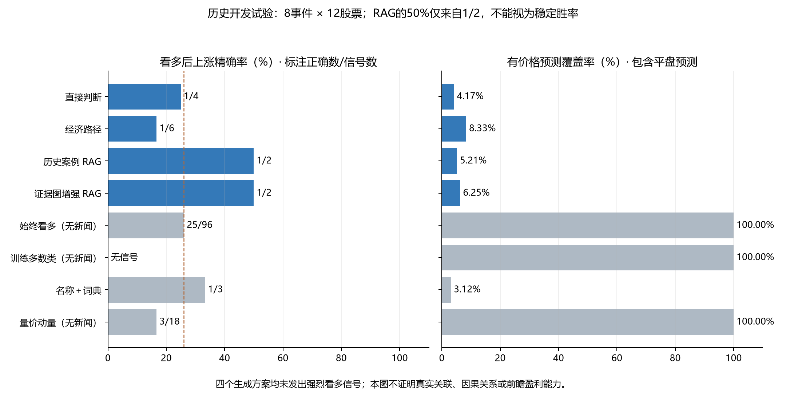

> 范围调整：本实验在用户收敛需求之前完成，现仅作历史归档。当前目标是自选股业务关联与利好利空，结构见[当前设计](../../hot-stock-architecture.md)；本文的涨跌结果不作为当前功能验收标准。

# 热点到自选股：方案结构与历史对比实验

**结论：证据检索与公司角色结构已实现，但这轮没有证明任何生成方案具备稳定的短期预测能力。** 主试验RAG和图增强RAG均只发出2次看多判断、各正确1次；不能把50%当成稳定胜率。四个生成方案都没有发出强烈看多信号，无法验证“非常利好后真实大涨≥3%”的精确率。

总体结构、在线数据对象、推理边界和推广条件见[当时的实验设计](initial-price-design.md)。

## 冻结设计

主试验为8条事件 × 12只模拟自选股 = 96个配对，跨4个可获得日期。先按日期划分训练案例库（边界2026-10-16），再按固定哈希选4条广义产业/政策候选与4条其他市场事件，每日期最多2条，不按未来收益选择。50个训练期历史案例的结果在最早测试截点前均已成熟。

当前公司快照按known_at取历史版本；主试验87/96配对有资料，9条保持缺失。Qwen3-Embedding-0.6B只做已冻结全文向量检索，不训练；生成模型固定deepseek/deepseek-v4.1-flash、temperature=0、thinking.type=disabled。每组最多4只股票，最多2次调用，失败不换模型、不按正确率选重试。

四个生成方案：直接判断、相同资料的3段经济路径、加3个成熟历史案例的RAG、再加入条件性公司业务证据图。B至E共享当前新闻、公司资料、历史量价输入；RAG额外案例预算及证据图结构明确记录。另有名称＋词典、始终看多、训练多数类与过去5日动量基线。

主口径：新闻可获得后留5分钟处理时间，使用之后首个完整交易日开盘至第3交易日收盘，入场日算第1日。大跌≤−3%、跌(−3%,0)、平0、涨(0,3%)、大涨≥3%。1/5日是同一3日预测的敏感性诊断，不是另外训练的1/5日模型。

## 主试验：未来3交易日

主试验96条均有合格行情：实际上涨25/96（26.04%），实际≥3%为10/96；37条大跌、34条跌、0条平、15条涨、10条大涨。配对之间有同事件、同股票及重叠持有窗口，不能按96个独立样本理解。

| 方案 | 看多后上涨：正确/信号 | 强烈看多后≥3% | 看空后下跌 | 有价格预测覆盖率 | 弃答 / 失败 |
| --- | --- | --- | --- | --- | --- |
| 直接判断 | 1/4（25.00%） | 无信号 | 无信号 | 4.17% | 88 / 4 |
| 经济路径 | 1/6（16.67%） | 无信号 | 无信号 | 8.33% | 84 / 4 |
| 历史案例 RAG | 1/2（50.00%） | 无信号 | 无信号 | 5.21% | 87 / 4 |
| 证据图增强 RAG | 1/2（50.00%） | 无信号 | 1/1（100.00%） | 6.25% | 86 / 4 |
| 始终看多（无新闻） | 25/96（26.04%） | 无信号 | 无信号 | 100.00% | 0 / 0 |
| 训练多数类（无新闻） | 无信号 | 无信号 | 71/96（73.96%） | 100.00% | 0 / 0 |
| 名称＋词典 | 1/3（33.33%） | 无信号 | 无信号 | 3.12% | 93 / 0 |
| 量价动量（无新闻） | 3/18（16.67%） | 2/3（66.67%） | 56/78（71.79%） | 100.00% | 0 / 0 |

覆盖率包括明确预测平盘，不能把弃答当作预测正确。无信号时精确率无定义；生成模型的大涨召回均为0/10。训练多数类本轮为大跌，其总体方向判断随下跌行情可获高命中，但不说明新闻信息有效。

主试验每个生成方案92/96条通过输出与原文协议，均有4条失败。RAG和图增强的两次看多恰好是同一组配对，价格表现相同；证据图没有带来该指标的增量。输出更多路径没有改善看多精确率。

按日期块重采样的诊断在report.json中，但只有4个日期，且有信号日期更少，区间可能退化，不能视为稳健显著性。标签置换只作描述性弱零假设，不是考虑全部相关性的显著性检验。



## 经营利好与价格上涨分开看

下表是读取主指标之后补充的描述性诊断，没有据此修改方案。仅统计模型认为直接/间接相关且经营影响为positive的配对，允许该模型同时对价格弃答。

| 方案 | 经营利好配对数 | 之后上涨 | 之后≥3% | 看多信号覆盖的日期数 |
| --- | --- | --- | --- | --- |
| 直接判断 | 6 | 2 | 1 | 3 |
| 经济路径 | 10 | 2 | 1 | 4 |
| 历史案例 RAG | 7 | 2 | 1 | 2 |
| 证据图增强 RAG | 5 | 2 | 1 | 2 |

这些数字不是“真实关联”的准确率，也不能由涨跌反推模型因果路径正确。已输出不含未来价格和模型结果的盲标文件；在独立人工标注前，relation_accuracy保持空值。

## 补充挑战：关税与海峡报道

在主试验预测锁定后、未按价格挑选案例，按两个指定题材选取最早准入的完整存档版本，并对全部23只股票运行相同四个生成方案：

- 美国关税压力下墨西哥汽车出口变化的报道：实际可获得时间为2026-10-10。
- 伊朗威胁封锁霍尔木兹海峡的报道：本次使用的完整准入版本实际可获得时间为2026-10-13，不能将后来取到的完整正文倒放到10月8日。

它们是当时保存的报道情景，来源与事实仍需独立核实；标题中的威胁不应自动等同已经封锁。不存在可用的历史热榜排名。

共46个配对，其中中国中车601766的一个持有窗口出现复权因子变化，被预先规定的公司行为检查标为需核对，因此3日价格评测为45条。第一条报道时尚无满足条件的成熟历史案例，第二条可用3例；缺案例不填入未来数据。

| 方案 | 看多后上涨：正确/信号 | 强烈看多后≥3% | 有价格预测覆盖率 | 弃答 / 失败（45条合格行情内） |
| --- | --- | --- | --- | --- |
| 直接判断 | 1/1（100.00%） | 无信号 | 2.22% | 44 / 0 |
| 经济路径 | 无信号 | 无信号 | 0.00% | 41 / 4 |
| 历史案例 RAG | 无信号 | 无信号 | 0.00% | 37 / 8 |
| 证据图增强 RAG | 无信号 | 无信号 | 0.00% | 37 / 8 |
| 始终看多（无新闻） | 11/45（24.44%） | 无信号 | 100.00% | 0 / 0 |
| 训练多数类（无新闻） | 5/22（22.73%） | 无信号 | 48.89% | 23 / 0 |
| 名称＋词典 | 无信号 | 无信号 | 0.00% | 45 / 0 |
| 量价动量（无新闻） | 9/25（36.00%） | 2/10（20.00%） | 100.00% | 0 / 0 |

直接版仅1次看多正确，不能解释为可靠的100%。其他生成方案主要弃答，当前流程尚不能稳定产生覆盖足够的间接关联价格判断。两条报道不足以覆盖关税、地缘政治或整个热点榜场景。

## 审计、成本与复现

正式主试验96批、挑战48批，共144批生成任务，135批通过结构与引文校验；按股票配对为532/568条生成结果有效。失败保留分母。常见失败是直接关联引文未含对应公司身份，以及路径条数不符；没有在看成绩后修提示重跑。

独立从原始日线重新计算所有入场/出场、收益分桶、公司版本、历史案例成熟时间和CSV计数：主试验2369项、挑战1196项，共3565项实际数据核对通过。84项单元/回归检查通过（hot_stock_study、hot_news_board、hot_news）。

正式返回用量主试验484,179 token，挑战238,037 token，合计722,216；包括格式重试。另有12批不计成绩的接口/输出协议探测，单独保存；供应商实际账单未查询。

答案仅在本机评测目录；推理主机只收到packets与计划。密钥留在部署主机原配置，没有复制到实验包。远程目录为`/home/airhust/finpulse-deploy/shared/training-data/hot-stock-study-20261026-ce098042/`；本机为`.runtime/hot-stock-study/`。未修改线上配置或发布服务。

```bash
.venv/bin/python -m unittest tests.test_hot_stock_study tests.test_hot_news_board tests.test_hot_news -q
.venv/bin/python -m scripts.hot_stock_experiment prepare --help
.venv/bin/python -m scripts.hot_stock_experiment run --help
.venv/bin/python -m scripts.hot_stock_experiment evaluate --help
.venv/bin/python -m scripts.verify_hot_stock_study --help
```

完整数据：[主试验报告](main/report.json)、[主试验逐条CSV](main/predictions.csv)、[主试验计划](main/plan.json)、[主试验独立核对](main/verification.json)；[挑战报告](challenge/report.json)、[挑战逐条CSV](challenge/predictions.csv)、[挑战计划](challenge/plan.json)、[挑战独立核对](challenge/verification.json)。

## 当前可以决定什么

保留“事件→经济变量→公司业务角色→条件与反向风险”的可审计结构，RAG只提供证据，不将相似案例当作因果或胜率。价格幅度应作为独立预测/校准模块继续比较，不直接把业务利好强弱映射为≥3%。

这轮不选“胜出模型”上线。下一轮先修复输出协议、做独立关联盲标，并在新日期锁定预测；再研究结构化事件特征＋独立价格校准头，与量价基线同一时间划分对比。不能为了获得强烈看多信号，在当前测试结果上事后降低概率阈值。

限制：历史语料已用于其他开发；没有真实历史热度标签；没有人工关联金标准；不能排除模型预训练后验记忆；只有同事件ID/相同正文/URL排除，尚无语义事件聚类；池内参考不是市场指数；未计交易费用、涨跌停成交和盘口流动性。观察到同向价格不等于新闻造成价格。
