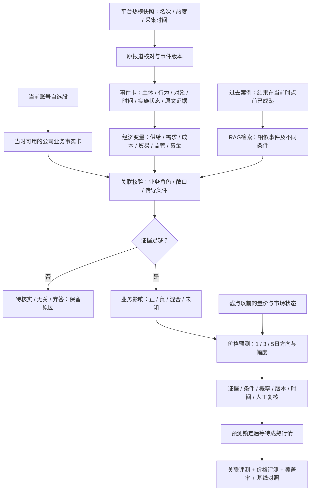

> 历史设计归档：用户已将当前功能收敛为自选股业务关联与利好利空判断，本文不再作为当前功能需求。

# 热点事件到自选股：证据结构与对比实验

## 产品结构

目标是回答三个独立问题：这条热点是否有经济影响入口；哪些自选股有证据支持的直接或间接关联；在明确时间窗口内，对价格的方向和幅度预测是否有统计价值。新闻热度、业务利好强弱和股价涨幅分别存储，不把三者视为同一个分数。

模型输出仅为可检查的简短依据及路径摘要，不要求或保存完整内部思维过程。输出必须同时允许“不相关”“资料不足”和“无法预测价格”。

## 数据对象与时间

| 对象 | 核心字段 | 约束 |
| --- | --- | --- |
| `TopicSnapshot` | source、rank、heat、observed_at、topic_url | 平台热度不可跨平台直接相加；不是事件真实性证明 |
| `EventVersion` | event_id、source_ids、published_at、first_seen_at、text_hash、event_state、evidence | 计划、威胁、传言、否认和已实施分开；正文更新不能沿用旧版本时间 |
| `CompanyFact` | code、name、aliases、business、known_at、source、quote | 只取known_at≤预测截点的版本；缺少历史资料必须保持缺失 |
| `EvidenceEdge` | subject、predicate、object、source_quote、known_at、edge_type | 资料事实与条件性经济假设分别标记；相似度不是关联事实 |
| `HistoricalCase` | 原事件、股票业务角色、预测截点、入场/出场、outcome_known_at、realized_return | 只检索在当前时点前结果已成熟的训练期案例，排除同事件和同正文 |
| `ImpactPrediction` | event_id、code、relation、business_impact、forecast_class、probabilities、conditions、input_hash、model | “经营利好”与“未来3日≥3%”分别输出；概率需独立校准才能解释为成功率 |

事实库存结构可沿用现有research_records做版本化原型。规模增加后，正文/事实卡与向量索引分开，向量索引需带known_at过滤；一批用户的自选股不是公共事实索引的一部分。

## 关联与推理怎么设置

先将事件压成结构化卡片，再检查业务角色，最后判断净影响。例如假设出现“航道受到封锁威胁”的报道：

- **事件事实**：材料说的是威胁还是已关闭，哪些时间和航运范围可以核实。
- **经济入口**：可能影响能源或货物流通、运费、保险费及供需预期，均有成立条件。
- **公司角色**：能源生产者、炼化使用者、承运商、用能企业可能方向不同；必须用该公司的业务资料证明其角色。
- **净影响**：收入、成本、竞争与风险可能相互抵消。没有业务占比、合同定价和净敞口时不能仅凭“石油相关”断言强烈利好。
- **价格预测**：即使经营受益，消息可能已反映、作用期过长或市场整体下跌，仍可能未来3日不涨。

在线候选池最多20只，可全部检查；向量或BM25检索只用于找证据和排序，不应因新闻没有公司名字或余弦相似度低就永久删掉候选。初版以最多3条经济传导边为限，每条标明原文事实或条件假设；关键业务角色没有证据时降为待核实。

RAG分别检索公司业务原文和历史事件，不把搜索“这次后来涨了多少”当作预测输入。案例应包含相似处、不同条件和当时已成熟的观察结果。检索排序不能按未来涨幅，也不能为了示例好看凑齐涨跌类别。

知识定位：**事件关系抽取、检索增强生成（RAG）、证据图 → 自然语言处理与知识表示**；验证价格表现属于**事件研究与时间序列回测**。学习顺序可从实体关联、point-in-time数据、检索与因果判断的区别开始。

## 同数据对比方案

首轮冻结生成模型、提示、输入、原文预算和历史资料时间。各方案在相同事件—股票配对上运行。

| 方案 | 当前新闻与公司资料 | 额外结构 | 要检验的问题 |
| --- | --- | --- | --- |
| A：名称＋词典 | 精确名称/别名＋正负关键词 | 无大模型 | 仅靠点名和词面是否足够 |
| B：直接判断 | 相同新闻、公司快照、历史量价特征 | 一次结构化输出，不要求路径 | 固定模型的最小可用对照 |
| C：经济路径 | 与B完全相同 | 经济变量→公司角色→短期价格条件，3条摘要 | 增加明确分析结构是否改善 |
| D：历史案例RAG | 与C相同 | Qwen冻结全文向量余弦检索3例；最多每股票1例 | 成熟历史案例是否提供增量信息 |
| E：证据图增强RAG | 与D相同 | 事件概念→业务原文→公司、附条件性领域桥接 | 业务角色与条件显式化是否改善 |

另有始终看多、训练期多数类和无新闻量价动量对照。始终看多不是有效关联模型，只用于暴露行情本身上涨带来的命中率。动量直接以过去5日收益分桶，不训练、不调参，属于简单弱基线。

本轮实现的E是**小型规则证据图原型**，不是已有完整产业知识图谱。桥接边是条件假设，不能伪装成经过核验的客户供应商关系。B至E均能看到同一份公司资料，E只改变组织结构，避免将资料增量误称为推理能力增量。D/E的历史案例是额外上下文，成本差异另报。

入口：`backend/hot_stock_study.py`、`scripts.hot_stock_experiment prepare/run/evaluate`。没有修改线上预测或自动交易接口。

## 评测口径

主目标为新闻实际可获得时间加5分钟之后的**首个完整交易日开盘**至第3个交易日收盘，入场日计为第1日。盘中新闻使用次日开盘；盘前消息若已过处理时间则可用当日开盘。1日和5日仅作同一3日预测的窗口敏感性诊断，不是另外训练的1日/5日模型。

分类为：大跌≤−3%、跌(−3%,0)、平0、涨(0,3%)、大涨≥3%。零收益保留，强烈看多必须明确预测≥3%，不能用“经营影响很强”替代价格预测。

主要报告：

1. **看多精确率**：看多/强烈看多之后，实际收益>0的正确数/发出该信号数。
2. **强烈看多精确率**：明确预测大涨之后，实际收益≥3%的正确数/发出强烈看多信号数。
3. 看空/大跌对应指标，真实各类别的召回、完整混淆矩阵。
4. 覆盖率、无关、弃答、失败、未成熟和缺失行情的数量；无信号显示“无样本”，不写成0%成功率。
5. 信号组平均收益与自选池其他股票等权收益差。后者只是池内参考，不是大盘超额收益；本轮没有市场指数基准。
6. 模型概率Brier诊断、按事件可获得日期整块重采样的探索性区间、标签置换对照、费用和调用数量。日期很少且窗口重叠，区间不代表稳健显著性。

输入与答案分别冻结，推理主机只接收输入及计划，当前目标答案不上传。所有股票按同一交易日历对齐；停牌/缺交易日不悄悄顺延。原始与前复权价格比例在持有窗口变化超过0.5%时将标签标为公司行为待核对，不冒充普通涨跌。前复权价格是源站口径，不等同于已实现含分红总收益。

严格保留新闻版本实际观测时间；公司快照按known_at截断。案例必须来自训练期且结果在预测前成熟，同URL、正文及事件不进入自身检索。多家公司同事件与同日行情相关，不能把96个配对称为96个独立事件。

## 哪些“相关性”结论还不能给

价格涨了不能作为真实关联标签：不相关股票也可能随大盘上涨，真的利好也可能被别的利空覆盖。关联质量需另做盲标：隐去未来行情及模型输出，让至少两名标注者对直接/间接/无关/未知和业务正反影响给出原文依据，再处理分歧。

本轮输出`relation-annotation-blind.json`待标注文件，不伪造人工金标准。没有独立标注时只报告关系判断数量与证据协议通过情况，关联准确率保持空值。模型语义正确与引文格式正确也分开。

当前历史语料缺少历史热榜快照，所以实验是**普通历史新闻回放**，不能证明百度/微博历史热榜的筛选效果；也无法排除模型预训练中记住后续行情。现有语料已在其他模型开发中使用，本轮不是全新留出或前瞻成绩。

## 下一阶段上线条件

先在新的热点日期锁定事件、公司事实和预测，待3/5个交易日结果成熟后统一评价。预先确定指标与推广门槛，保留失败和弃答，禁止看到涨跌后修改阈值、窗口或只展示成功新闻。小样本最高百分比不自动成为推荐方案。

通过新日期及人工关联评测后，在线服务可采用“事件提取一次→当前账号全部自选股事实检索→分批关联与影响判断→严格输出校验→账号私有结果缓存”。缓存键包含事件版本、股票代码、业务事实版本、模型与提示版本，读取结果不触发付费生成；POST复用登录、CSRF与额度控制。原新闻链接、事实证据和可能路径应与价格预测分别展示。

参考：新闻对初始市场反应与后续可交易收益需要区分，见[Lopez-Lira与Tang](https://arxiv.org/abs/2304.07619)；文本释放时点的处理和时间感知建模见[FAST论文](https://aclanthology.org/2021.eacl-main.185/)。这些论文支持评测设计的讨论，不证明本项目的具体方案有效。

## 本轮实际产物

[2026-10-26对比报告](experiments/2026-10-26-hot-stock-study/README.md)包含8条随机固定事件×12只模拟自选股的主试验，以及关税/海峡两条存档报道×23只股票的补充挑战。四个生成方案和四个基线均在同一组内配对比较，不将两组口径混成单一胜率。结果没有证明稳定预测优势，强烈看多信号缺失。

本轮只实现同事件ID、相同正文哈希和URL的检索排除，尚无完整语义事件聚类；重复报道可能残留。量价输入和弱动量基线基于原始历史收盘，未进行全面的历史公司行为调整；标签窗口的复权比例检查不代表输入特征已完全消除除权影响。
