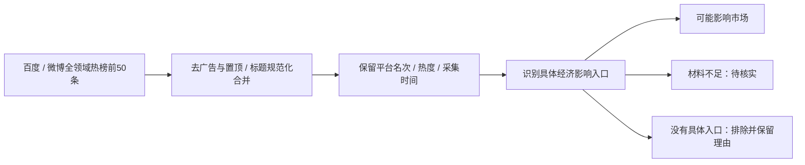

# 全领域热点榜单：市场相关性初筛

## 当前目标

从百度、微博等**全领域平台热榜**选取候选，再筛选可能通过经济变量影响股市、产业或企业经营的热点。财经新闻只是其中一类，关税、国际冲突、航道、灾害、科技、消费与监管事件同样参与。

每张新闻卡片依次展示新闻、可能受影响的板块（方向与理由）、自己的相关自选股（逐股方向与传导理由）。登录后自动批量读取已有自选股判断；首次点击「分析我的自选股」生成结果，点击「全部自选与证据」查看完整依据，资料不足保留待核实。当前功能不读取行情，也不输出涨幅或收益预测。

入口为主导航「热点榜单」，也可访问 `/?view=hot-news`。任何访客都可读取已有快照；登录后可主动点击「更新热点」。榜单不依赖是否添加自选股。

前端可组合使用关键词（标题或摘要）、平台来源、七种经济影响类型、筛选结论、热度/最近采集排序，以及20/50/100条展示上限。默认展示可能影响市场的热点；切换条件由后端统一返回结果和数量，支持一键重置。关键词输入有250毫秒防抖，旧查询响应不会覆盖新查询结果。

数量统计按当前平台、关键词和影响类型计算，先统计各筛选结论，再应用结论标签与展示上限。因此“匹配数量”不会因只展示前20条而缩小。按单个平台筛选时，排序只使用该平台名次。最近采集指平台快照采集时间，不是新闻发布日期。

## 筛选流程



**热度和市场相关性分别判断**：平台上榜证明它是平台热点；是否可能影响股市，由经济入口筛选。不同平台的原始热度值不相加。合并话题使用 `sum(1 / (60 + 平台名次))` 排序，页面仍保留各平台原始排名和热度。它不是预期涨跌幅、事件严重度或影响大小的排序。

只对规范化后完全相同的标题合并，包括标点、空格、全半角、话题井号等差别；不冒险把所有相似标题合成同一事件。尚未实现语义事件聚类。

## 什么样的热点纳入

筛选可解释的入口包括贸易与进出口、供给与供应链、成本与商品价格、消费与行业需求、政策与监管、利率与资金、经营与市场风险。

| 情景示例，不代表已发生事实 | 初筛关注点 |
| --- | --- |
| 美国加征关税 | 贸易成本、订单、市场准入 |
| 霍尔木兹海峡通航受阻 | 能源和货物流通、运输成本 |
| 央行调整利率 | 融资成本与需求 |
| 台风造成港口停航 | 实际运输和供给中断 |
| 科技产品量产或重大技术变化 | 产业供给、竞争、商业需求 |
| 明星私生活或普通饭圈讨论 | 无具体经济入口时排除 |
| 明星代言品牌遭重大处罚 | 商业或监管事件仍可纳入，不按娱乐标签一刀切 |
| 历史战争纪念或未证实的“封锁”传言 | 待核实，不当作当前冲突或供应中断 |

这里只描述**可能的影响入口**，不直接推出某只股票利好或利空。“热点”也不证明事件真实。每条保留标题/平台摘要的原文引用，采集时间不伪装成新闻发布日期，平台话题链接不冒充原始报道。

## 模型与规则

有本地模型配置时，复用现有生成接口，每组最多5条、最多并行2组，要求恰好覆盖输入ID，返回 `keep / review / exclude`、经济入口、筛选理由、逐字引文及最多3个板块假设。每个板块包含规范ID、业务方向、理由与新闻引文。后端检查话题覆盖、字段一致性、板块/经济入口枚举、板块去重及引文是否在输入中；排除项不允许板块影响。

筛选结果按提示词版本、标题、摘要、请求模型和接口地址共享缓存。密钥不进入缓存键和模型输入。原始平台名次变化不触发相同内容的重复模型分析；内容或请求模型变化会使缓存失效。

无配置、接口失败或校验失败时，回退到**明确标记的规则初筛**。规则识别关税、航道、宏观、资源、冲突、灾害、科技、基建和经营事件，保留引用上下文；材料不足、传闻、否认或问题进入待核实。失败结果不缓存成成功模型输出。规则存在误选和漏选，待核实区用于保留这种不确定性；格式和引文通过也不证明语义推断正确。

技术知识定位：这是**事件筛选与分类 → 自然语言处理 / 信息检索**。后续从事件到具体股票，需要加入“经济变量 → 产业环节 → 公司经营角色”的证据关联，属于事件关系抽取与知识表示；公司链路已接入主营原文检索及逐股核对，详见[自选股结构](hot-stock-architecture.md)。

## 来源、缓存与接口

- 百度适配器读取公开页面的内嵌JSON，保留真实名次、热度、摘要，跳过置顶与广告。实际检查得到50条话题。
- 微博适配器读取公开热搜JSON。当前环境实测HTTP 403，明确显示暂不可用；不绕过登录、验证或访问限制。微博成功响应的解析目前通过构造数据测试，尚未在当前环境验证成功读取。
- 每10分钟复用共享快照，包括失败后的短期冷却；刷新使用跨进程1500秒租约，重复任务返回409。当前仅手动更新，无自动调度。
- 单来源失败时其他来源继续；有旧快照则保留原采集时间并标旧，最长保留一小时。读取时过期来源从话题及融合排序中移除；所有来源都不可用时返回空榜和来源状态，不以财经搜索替代热榜、不制造示例热点。
- `GET /api/hot-news`：公开只读，读取缓存，不触发网络或生成。
- `POST /api/hot-news/refresh`：登录、同源和CSRF校验，每账号15分钟最多8次，主动采集及筛选。
- 响应均为 `Cache-Control: no-store`，数据存于已有 `research_records` 的 `hot_news_board` 与 `hot_news_screen` 命名空间，无数据库迁移。
- 上一版公司关联原型代码仍保留于 `backend/hot_news.py`，当前应用不实例化它；页面与API使用 `HotNewsBoardService`。

### 只读筛选参数

示例：`GET /api/hot-news?decision=keep&source=baidu&channel=trade&q=关税&sort=hot&limit=20`。

| 参数 | 范围 / 默认值 |
| --- | --- |
| `decision` | `all`（接口默认）、`keep`、`review`、`exclude`；页面默认`keep` |
| `source` | `all`（默认）、`baidu`、`weibo` |
| `channel` | `all`（默认）、`trade`、`supply`、`cost`、`demand`、`regulation`、`funding`、`risk` |
| `q` | 最多80字符；全半角归一、忽略英文大小写，按普通文本搜索标题与摘要 |
| `sort` | `hot`（默认）、`latest`（最近采集） |
| `limit` | 1到100，接口默认100、页面默认50 |

响应包含`items`、当前范围的`counts`、应用结论筛选后的`matched_total`、全部有效候选数`candidate_total`及生效的`filters`。参数越界或非法枚举返回422。影响类型适用于已识别经济入口的事件，选择某一类型时待核实/排除项通常为0。筛选过程不修改共享缓存、不触发采集或模型调用。

## 本轮验证与边界

2026-10-26只读检查公开入口：百度200，微博403。独立本机探测数据库与结果存于 `.runtime/hot-news-probe/`，没有访问部署服务器、请求生产模型或部署。

冻结的一批50条百度话题经当前规则初筛为4条可能影响、43条待核实、3条排除。这个数量只说明规则运行和数据留存情况，不是准确率或完整覆盖率。实样发现的“历史战争纪念误判为当前冲突”已修正并加入回归测试。模型筛选仍需真实配置联调，并以人工标注样本评估误选率和漏选率。

```bash
.venv/bin/python -m unittest tests.test_hot_sectors tests.test_hot_stock_impact tests.test_hot_news_board tests.test_hot_news -q
npm run build
```

`tests/test_hot_news_board.py` 覆盖平台解析、广告/置顶过滤、排名融合、同标题合并、关税/航道等非财经事件、文娱商业例外、历史/传闻区分、逐字引文、模型缓存与失败回退、来源降级和过期、限流之外的任务租约及公开只读接口。旧公司关联原型测试继续保留。

本轮当前相关86项测试通过，覆盖组合筛选、板块相反方向及引文校验、账号私有批量读取、逐股主营证据、失败重试与缓存失效等。生产构建通过。

`tests/hot_news_ui.mjs` 使用清楚标记的测试情景，验证访客读取、空自选股也可使用、关键词/影响类型/平台/结论筛选及真实请求参数、排序、展示条数、空结果重置、403及旧快照展示、依据展开、主动更新、重载只读、深浅色及390px布局，并确认浏览只读取缓存、显式分析才发出个股推理请求；还验证板块正反方向、新闻下方自选股直接展示、逐新闻结果隔离与重载复用。运行时用HTTP服务托管 `dist/`（默认8016端口），通过 `PLAYWRIGHT_CORE_PATH`、`CHROME_PATH` 指定本机Playwright与浏览器，必要时设置 `HOT_NEWS_UI_BASE_URL`、`HOT_NEWS_UI_OUTPUT`。

## 自选股业务关联与影响

“事件→经济变量→公司业务角色”的[详细结构与当前接口](hot-stock-architecture.md)已经接入本分支页面与API。只判断哪些自选股有关、业务利好或利空及依据，不以随后股价涨跌作为关联成立标准。此前的行情实验仅作历史归档，不是当前功能验收要求。

### 板块层

共享板块假设随热榜初筛一并生成，无须为每个账号重复生成。模型依据话题材料从有界板块目录选择最多3项；无配置或模型校验失败时由明确标注的规则给出条件路径。旧快照缺少板块字段时，GET仅作本地规则补充，不触发模型；模型主动返回空数组时不强行补充。

方向为利好、利空、正反并存或影响不明，表示可能的业务传导，并非板块涨跌预测。示例情景：原油价格上行可能增加资源生产端收入、增加航空燃油成本，炼化企业则需核对加工价差；航道受阻对承运商可能同时改变运费、绕航及保险成本。普通关税消息缺少产品与地区信息时保留正反并存，不能统一推定所有出口企业受损。

板块只是逐股核对的候选路径，不作为公司身份或实际敞口的证明。自选股判断仍需本公司主营原文；不把整个板块方向复制给每家公司，也不只检查落在候选板块内的股票。
