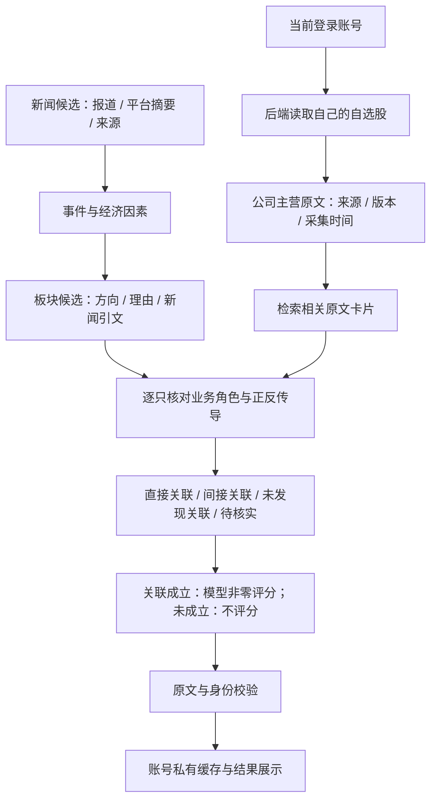

# 热点与自选股：关联及利好利空结构

## 当前目标（2026-10-27更新）

输入热点事件和当前账号自选股，先核对直接/间接关联，再由模型直接给出−10至+10的非零整数股价影响分。负分代表预期利空、正分代表预期利好，绝对值为影响强度；确认有关联后必须选择净方向，反向因素写入理由和条件，不以“正反并存”替代评分。关联不足或未发现关联用null，禁止用0冒充未知。

评分关注新闻带来的声誉、产品安全、监管、需求、成本和市场情绪变化，并非涨跌百分比或概率。没有读取行情、训练价格预测模型或用事后涨跌反推正确性。旧的纯业务方向缓存和一键任务已按版本失效，需重新分析生成分数。

热点热度与业务影响方向是不同字段。新闻整体语气积极不代表对所有相关公司利好，例如生产者、使用者和承运商可能受到相反影响。

## 已实现的判断链路

1. **热点材料**：从当前有效榜单读取新闻资料和来源。资讯接口可提供正文、发布时间及发布者，平台话题仍使用标题/摘要；来源入口不冒充文章原文URL，采集时间不冒充事件发生时间。只有通过重要新事件门槛的新闻才公开展示。
2. **板块假设与自选股身份**：热榜初筛同时生成最多3个板块候选，区分生产者、使用者等角色；不确定时显示正反并存或影响不明。板块层是公共候选，不能替代逐股主营核对。自选股由后端根据登录用户ID读取，客户端不能指定其他账号或额外股票。最多20只逐一考虑，不因新闻没有公司名就删掉候选。
3. **主营事实与检索增强**：复用已有主营业务源和七天共享缓存，将原文切为有重叠的卡片，以热点文字定位相关段落，最多提供3张卡。每张保留原文、偏移、来源和版本关联。相似词只用来定位，不能作为“相关”或“利好”的证明；同时保留完整的有界主营文本，避免关键词检索漏掉间接影响。
4. **事件到业务角色**：让模型核对供给、需求、成本、贸易、监管或资金条件如何触及这家公司的业务。不能编造供应商关系、实际海外收入、业务占比、合同和净敞口。新增公司关系检索：从交易所、巨潮披露材料检索品牌、产品和制造合作关系，保留原文卡片及URL，缓存7天；该证据独立于F10主营，不伪装成主营原文。资料不足就待核实。
5. **关联先于方向**：直接关联需新闻引文包含目标公司名称、代码或别名；间接关联需同时引用新闻及目标公司主营或品牌/产品关系原文。关联成立后模型直接给非零整数评分，符号决定方向，记录主导因素与反向风险。未发现关联/关联未知不评分。
6. **协议与原文校验**：股票集合必须与输入完全一致，禁止遗漏、重复、额外股票；逐字核对新闻和主营引用，校验字段枚举。平台摘要和新闻服务正文尚未独立核实，证据可信度保持低，不伪装成已完成事实核验。
7. **失败与重试**：每组最多5只股票，最多并行2组；一组失败不会丢弃其他组成功结果。失败单独保存为未完成，不能当作无关。再次分析只补充未完成部分，已完成且证据未变的结果复用。

知识定位：**实体关联、事件关系抽取与检索增强生成（RAG）→自然语言处理与知识表示**。这里的RAG检索公司业务原文，不检索“新闻之后股票是否涨了”。当前是透明的文本卡片检索，尚不是完整产业知识图谱。

## 输出结构

每只股票包含代码、名称、处理状态，以及：

- `relation`：`direct / indirect / none / uncertain`。
- `score`：−10至+10非零整数，仅对直接/间接关联给分；无关/关联待核实为null。
- `direction`：评分正负对应`positive / negative`；未评分为`unclear`，不能与分数符号冲突。
- `relationship_evidence`：公司品牌/产品/制造关系的逐字引文、资料卡ID及来源URL。
- `mechanism`：具体业务传导与主导因素，最多240字。
- `news_evidence`、`business_evidence`：新闻与主营原文引用，附资料来源。
- `uncertainty`：成立条件、反向风险和缺失证据。
- `confidence`：证据可信度，属于证据质量描述。

不包含`forecast`、`probabilities`、`return`或任何涨幅阈值。当前来源未独立核验时不提供高可信度结论。

## 接口和缓存

- `GET /api/hot-news/analysis-batch?ids=topic1,topic2`：登录后批量读取最多100条热点对应的自己的判断。只读取一次榜单与自选股、批量读取私有缓存，不附加重复的完整主营资料；过期热点返回`missing_ids`。
- `GET /api/hot-news/{topic_id}/analysis`：登录后读取当前自选股的已保存判断，不调用外部源或模型。
- `POST /api/hot-news/{topic_id}/analyze`：复用同源、CSRF及账号校验，每账号15分钟最多8次；主动更新需要的主营缓存，再补全关联判断。
- 账号ID与自选股从服务端读取，模型不会得到账号资料。判断保存在`hot_stock_impact`私有命名空间，读写均带owner。
- 缓存键绑定提示词版本、热点标题/摘要/来源链接及板块假设、股票身份及主营资料版本、配置模型与接口地址。热度、名次、采集时间变化不重复付费分析；材料或主营事实变化使缓存失效。
- 单账号同热点使用600秒跨进程租约，重复提交返回409；单进程最多2个热点分析请求，繁忙返回429。热点已离开有效榜单返回404。
- 响应均为`Cache-Control: no-store`，没有数据库迁移，没有新增自动任务。

## 页面

每张热点卡片依次展示新闻、可能受影响的板块和自己的相关自选股。板块展示方向、理由、新闻引文及规则/模型来源。登录后按当前榜单批量读取已保存个股判断，首屏不自动生成；点击「分析我的自选股」后直接在新闻下方显示有关联的公司、利好利空和具体传导理由。未发现关联计数、待核实名单、未完成与失败状态分开展示。

点击「全部自选与证据」打开明细，可筛选有关联、利好、利空、待核实/未完成或全部自选，查看业务路径、条件、新闻/主营引文及来源。弹窗分析与卡片结果同步。空自选股、来源不足与部分失败分别展示；刷新页面和重新打开弹窗只读取，不自动调用模型。账号、自选股、筛选条件或热点材料变化时旧读取结果不能覆盖新范围。

## 验证与现状

核心文件：`backend/hot_sectors.py`、`backend/hot_stock_impact.py`、`src/HotTopicImpacts.tsx`、`src/HotStockImpactPanel.tsx`。相关测试86项通过，生产构建通过；浏览器覆盖榜单筛选、板块及自选股直接展示、弹窗、相反业务方向、引文、失败重试、只读复用和手机布局。页面检查使用清楚标记的测试资料，未对真实关联准确率作结论。后续发布已部署`3d07a4a`，并用服务器现有模型初始化公共热榜；真实个人账号的逐股分析未在此次发布验收中执行，关联准确率仍未得到独立评估。详见[发布记录](superpowers/reports/2026-10-26-hot-news-release.md)。

关联质量应通过独立核对新闻事实、公司业务角色、每条传导关系来评价，不能用之后的股票涨跌反推其正确性。历史价格对比实验已归档于`docs/experiments/2026-10-26-hot-stock-study/`，不再作为当前功能验收目标。

## 批量匹配与汇总

`HotNewsMatchService`在上述单条新闻判断上组合后台任务。一次点击捕获当前展示的新闻集合，后端读取账号自选股，准备主营资料，再逐新闻完成股票集合判断。复用原有私有缓存和证据校验，不新增涨幅、收益或价格预测概率。

任务返回已处理配对数、失败数、证据不足数，以及按股票分组的相关新闻。相反新闻分别显示方向，不把它们压成股票的单一结论；逐新闻结果同步回原卡片。进程内有限队列、账号租约和心跳控制并发，任务与结果均按owner隔离。新范围或自选股变化需用户重新点击，页面只读轮询不会自动产生付费分析。

## 全民热点与重复上榜

采集后先对具体事件归组，再筛选，避免把事件起因和品牌回应拆开后漏掉公共关注。归组要求完整ID覆盖、多条成员共享材料中真实存在的具体主体词；生成标题不作为新事实，页面沿用来源标题并保留成员报道。归组失败明确提示并保留单条，不能编造热搜次数。

关注度来自真实平台上榜条数、不同平台数和近24小时不同采集快照；同一榜单的多个相关标题分别计数，转载资讯不计热搜。读取/轮询不增加次数，旧来源回退不冒充重新上榜，历史最多保留144次。排序关注度与模型影响分独立。泛“伟大征程”等无指向宣传在独立发布门槛排除。

## 关系知识与评分标尺复核

通用检索可能只返回旧资料，漏掉最新品牌关系。初始知识库`backend/knowledge/company_relationships.json`补入人工核对的江淮汽车2025年年报（尊界合作产品）、东鹏饮料2026年中报（补水啦及姆巴佩代言）摘录，保留官方URL、核对日期与有效期；只保存事实关系，不保存方向或分数。其他公司继续用披露检索，资料不足不臆造关联。

评分标尺明确：广泛上榜、直接卷入重要品牌声誉或产品安全危机、且无实质消除证据时按强负面事件（通常−6至−8）评估；已澄清、影响局限或舆情逆转时按材料调整。该标尺是一种主观事件影响评价口径，不是未来股价校准。

模型输出未通过字段或引文校验时仅允许一次结构/引文修复，重新校验后仍失败就保留未完成。不会为了某个目标分数重复抽样；无关对照不评分。
