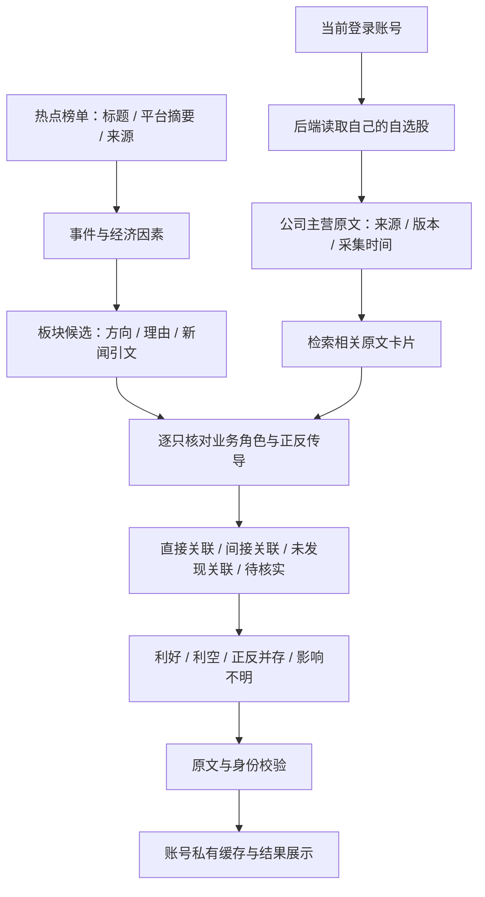

# 热点与自选股：关联及利好利空结构

## 当前目标

输入一条热点和当前账号自选股，逐只回答：是否直接或间接有关、对公司业务可能是利好还是利空、依据和成立条件是什么。当前功能不读取行情，不输出收益、涨幅、持有窗口或价格预测概率，也不用之后是否上涨来定义关联是否成立。

热点热度与业务影响方向是不同字段。新闻整体语气积极不代表对所有相关公司利好，例如生产者、使用者和承运商可能受到相反影响。

## 已实现的判断链路

1. **热点材料**：从当前有效榜单读取标题、摘要和来源链接。平台话题入口不冒充原始报道；采集时间不冒充事件发生时间。
2. **板块假设与自选股身份**：热榜初筛同时生成最多3个板块候选，区分生产者、使用者等角色；不确定时显示正反并存或影响不明。板块层是公共候选，不能替代逐股主营核对。自选股由后端根据登录用户ID读取，客户端不能指定其他账号或额外股票。最多20只逐一考虑，不因新闻没有公司名就删掉候选。
3. **主营事实与检索增强**：复用已有主营业务源和七天共享缓存，将原文切为有重叠的卡片，以热点文字定位相关段落，最多提供3张卡。每张保留原文、偏移、来源和版本关联。相似词只用来定位，不能作为“相关”或“利好”的证明；同时保留完整的有界主营文本，避免关键词检索漏掉间接影响。
4. **事件到业务角色**：让模型核对供给、需求、成本、贸易、监管或资金条件如何触及这家公司的业务。不能编造供应商关系、实际海外收入、业务占比、合同和净敞口。资料不足就待核实。
5. **关联先于方向**：直接关联需新闻引文包含目标公司名称、代码或别名；间接关联需同时引用新闻和目标公司主营原文。综合正反条件后给业务利好、利空、正反并存或影响不明。未发现关联/关联未知不能输出有方向的结论。
6. **协议与原文校验**：股票集合必须与输入完全一致，禁止遗漏、重复、额外股票；逐字核对新闻和主营引用，校验字段枚举。当前输入只有热榜标题/摘要，证据可信度统一降为低，不伪装成已核实正文。
7. **失败与重试**：每组最多5只股票，最多并行2组；一组失败不会丢弃其他组成功结果。失败单独保存为未完成，不能当作无关。再次分析只补充未完成部分，已完成且证据未变的结果复用。

知识定位：**实体关联、事件关系抽取与检索增强生成（RAG）→自然语言处理与知识表示**。这里的RAG检索公司业务原文，不检索“新闻之后股票是否涨了”。当前是透明的文本卡片检索，尚不是完整产业知识图谱。

## 输出结构

每只股票包含代码、名称、处理状态，以及：

- `relation`：`direct / indirect / none / uncertain`。
- `direction`：`positive / negative / mixed / unclear`，分别显示利好、利空、正反并存、影响不明。
- `mechanism`：具体业务传导与主导因素，最多240字。
- `news_evidence`、`business_evidence`：新闻与主营原文引用，附资料来源。
- `uncertainty`：成立条件、反向风险和缺失证据。
- `confidence`：证据可信度，属于证据质量描述。

不包含`forecast`、`probabilities`、`return`或任何涨幅阈值。当前热榜只有摘要时不提供高可信度结论。

## 接口和缓存

- `GET /api/hot-news/analysis-batch?ids=topic1,topic2`：登录后批量读取最多100条热点对应的自己的判断。只读取一次榜单与自选股、批量读取私有缓存，不附加重复的完整主营资料；过期热点返回`missing_ids`。
- `GET /api/hot-news/{topic_id}/analysis`：登录后读取当前自选股的已保存判断，不调用外部源或模型。
- `POST /api/hot-news/{topic_id}/analyze`：复用同源、CSRF及账号校验，每账号15分钟最多8次；主动更新需要的主营缓存，再补全关联判断。
- 账号ID与自选股从服务端读取，模型不会得到账号资料。判断保存在`hot_stock_impact`私有命名空间，读写均带owner。
- 缓存键绑定提示词版本、热点标题/摘要/来源链接及板块假设、股票身份及主营资料版本、配置模型与接口地址。热度、名次、采集时间变化不重复付费分析；材料或主营事实变化使缓存失效。
- 单账号同热点使用600秒跨进程租约，重复提交返回409；单进程最多2个热点分析请求，繁忙返回429。热点已离开有效榜单返回404。
- 响应均为`Cache-Control: no-store`，没有数据库迁移，没有新增自动任务。

## 页面

每张热点卡片依次展示新闻、可能受影响的板块和自己的相关自选股。板块展示方向、理由、新闻引文及规则/模型来源。登录后按当前榜单批量读取已保存个股判断，首屏不自动生成；点击「分析我的自选股」后直接在新闻下方显示有关联的公司、利好利空和具体传导理由。未发现关联计数、待核实名单、未完成与失败状态分开展示。

点击「全部自选与证据」打开明细，可筛选有关联、利好、利空、待核实/未完成或全部自选，查看业务路径、条件、新闻/主营引文及来源。弹窗分析与卡片结果同步。空自选股、来源不足与部分失败分别展示；刷新页面和重新打开弹窗只读取，不自动调用模型。账号、自选股、筛选条件或热点材料变化时旧读取结果不能覆盖新范围。

## 验证与现状

核心文件：`backend/hot_sectors.py`、`backend/hot_stock_impact.py`、`src/HotTopicImpacts.tsx`、`src/HotStockImpactPanel.tsx`。相关测试86项通过，生产构建通过；浏览器覆盖榜单筛选、板块及自选股直接展示、弹窗、相反业务方向、引文、失败重试、只读复用和手机布局。页面检查使用清楚标记的测试资料，未对真实关联准确率作结论。后续发布已部署`3d07a4a`，并用服务器现有模型初始化公共热榜；真实个人账号的逐股分析未在此次发布验收中执行，关联准确率仍未得到独立评估。详见[发布记录](superpowers/reports/2026-10-26-hot-news-release.md)。

关联质量应通过独立核对新闻事实、公司业务角色、每条传导关系来评价，不能用之后的股票涨跌反推其正确性。历史价格对比实验已归档于`docs/experiments/2026-10-26-hot-stock-study/`，不再作为当前功能验收目标。
