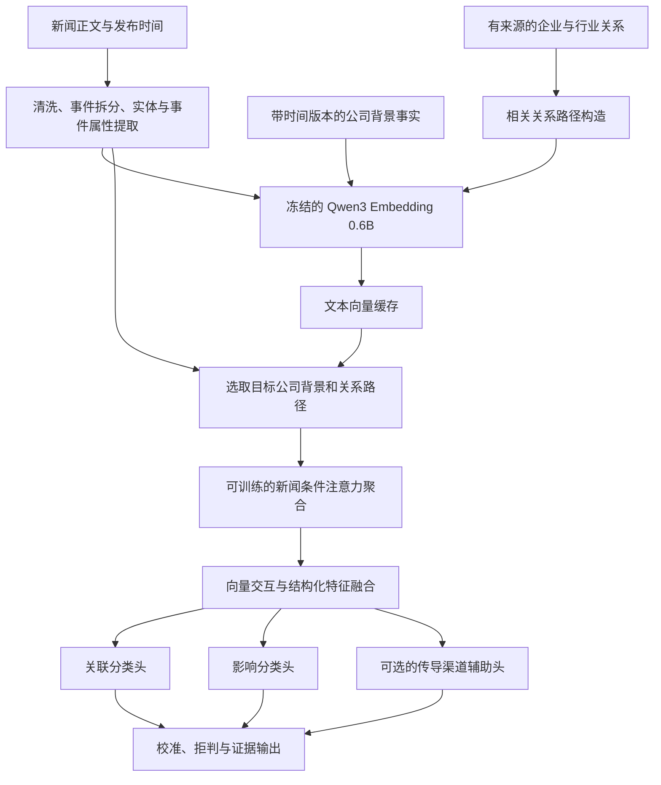

# 新闻—股票关联与影响模型设计

状态：待评审设计，尚未训练或部署。日期：2026-10-20。

## 1. 任务边界

输入一条新闻、目标股票、分析时点及该时点已经公开的公司资料，输出：

- 关联类型：直接相关、间接相关、无关、证据不足。
- 对相关公司的影响：利好、利空、正负混合、影响轻微、证据不足。
- 支持判断的新闻片段、公司事实、关系路径，以及成立条件。

“相关”指存在可说明的经营、资产负债、治理、法律或市场预期传导渠道。仅行业相同、词语相近，不足以判定相关。
方向标签表示新闻在指定分析窗口内对公司的预期影响，不等同于未来股价涨跌。第一版统一标注“未来约一个月内可预期的影响”，允许明确记录更长期影响，但不混入第一版主标签；后续再增加时间窗口输入。

模型不以自由生成的长篇思考过程作为训练目标。优先训练关联、方向与证据选择，让解释落到可核验材料。

## 2. 总体结构



第一版固定 Qwen3 权重，训练投影、注意力及分类网络。向量离线缓存，训练时不加载 Qwen3，因此可在之前检查到的约 4 GiB 显存环境上尝试；实际批量和耗时以基准测试决定。暂不进行大模型全量微调、强化学习或大型图神经网络训练。

## 3. 公司背景：多条事实，而非一个不可拆分的大向量

每家公司有多张事实卡；每张卡描述一个可核验事实，通常一至三句话。概览向量作为对照基线保留。

| 类型 | 内容 | 附加结构字段 |
| --- | --- | --- |
| 身份 | 公司、品牌、子公司、曾用名 | 股票代码、实体 ID、关系类型 |
| 主营 | 产品、服务、业务分部 | 业务类型、报告期、已披露收入占比 |
| 成本与供应 | 原材料、能源、供应商依赖 | 输入品、采购地区、成本占比 |
| 客户与区域 | 下游行业、客户、销售市场 | 地区、客户行业、销售占比 |
| 合作与竞争 | 股权、供货、合作、竞争关系 | 主体、客体、方向、有效期 |
| 风险与状态 | 诉讼、召回、制裁、在建项目 | 状态、事件时间、失效时间 |

金额、收入比例、价格变化等保留数值、单位和缺失标记，不能指望向量精确保留数值。实体别名同时建精确检索表。

事实卡示例，以下公司与数值均为结构示意：

```json
{
  "fact_id": "company_A_business_001_v1",
  "company_id": "company_A",
  "kind": "business",
  "text": "公司A经营原油勘探与开采业务。",
  "entity_ids": ["company_A", "crude_oil"],
  "relation": "produces",
  "numeric_features": {"revenue_share": null},
  "source_document_id": "report_001",
  "source_span": {"start": 120, "end": 138},
  "published_at": "2026-04-01T09:00:00+08:00",
  "observed_at": "2026-04-01T09:10:00+08:00",
  "valid_from": "2026-04-01T09:00:00+08:00",
  "valid_to": null
}
```

保存公开时间、系统获取时间和业务有效期，不能用业务生效日代替公开时间。历史回测只使用分析时点可获得的版本；没有历史资料快照的样本不能宣称满足严格时点回测。关系变更追加版本，不覆盖历史。

## 4. 新闻表示与间接关系

新闻至少保留标题、正文片段和事件单元。长新闻按自然段切块，保留原文偏移；超过上限时记录覆盖范围，不静默截断。多事件新闻先分别预测，再呈现冲突或混合影响。

可用规则及现有生成模型提取：

```text
主体、动作、对象、事件类型、发生时间、
否定、已经发生/预测/传闻、证据来源、原文片段
```

提取结果需要字段校验及原文支持；无法确定的字段标为未知。原文向量与提取后的事件向量均保留，避免抽取错误抹掉原始信息。

间接关联采用有限的显式关系检索：

1. 从新闻识别企业、产品、商品、地区、运输通道等实体。
2. 用有来源的关系表找到目标公司，一期限制最多两条关系边。
3. 将路径转成保留方向和关系类型的文本，再编码；结构字段另行输入。
4. 事实边与经济传导假设分开记录。假设如“供应减少可能推高价格”有条件、版本及依据，不冒充新闻中已经发生的事实。

例如“运输通道中断—影响原油供应—原油开采公司”和“原油—航空燃油成本—航空公司”提供不同渠道。公司同时有采油与炼化业务时保留两侧路径，不预设净方向。简单两跳无法覆盖的复杂路径列为覆盖不足，不自动补造。

## 5. 可训练网络

### 5.1 输入张量

设一批样本数量为 B；以下是第一版可调上限：

| 输入 | 形状 | 说明 |
| --- | --- | --- |
| 新闻/事件向量 N | B × 8 × 1024 | 原文片段及事件文本，有效位置掩码 |
| 公司事实向量 F | B × 32 × 1024 | 召回候选事实，附类型和时效字段 |
| 路径向量 P | B × 8 × 1024 | 有来源的有限路径，附关系类型 |
| 结构化特征 x | B × d | 实体命中、事件属性、数值与缺失标记等 |

新闻片段与事实向量使用冻结的同一 Qwen3 版本及规范。先采用无指令文本编码作为可比基线；检索任务指令作为独立实验，一旦启用，固定查询/文档格式并重新构建所需缓存。不同模型版本或编码规范不可混用。

### 5.2 编码与聚合

各类输入经可训练线性层从 1024 投影至 256 维，再加入类型编码并归一化。新闻片段用小型注意力池化形成 n；新闻中的事件、否定、确定性等结构字段参与后续融合。

事实选择以新闻为条件：

```text
q = Wq n
k_i = Wk f_i
v_i = Wv f_i
alpha = masked_softmax(q · k_i / sqrt(256) + metadata_bias_i)
c = sum_i alpha_i v_i
```

路径以同样方式形成 r。metadata_bias 由资料类型、时效、来源可核验性、实体关系等特征的小网络产生。缺失公司事实或路径时使用显式缺失向量与标记，避免全掩码 softmax 产生 NaN。

为减少长简介掩盖关键业务的问题，候选事实按类型保留最低配额，并加入精确实体和关系命中，不能只按原始余弦分数截取。训练有证据标注时，把遗漏的正证据补入训练候选；评测时不得补入，并单独报告证据召回率。

### 5.3 交互与分类

```text
h = concat(
  n, c, r,
  n * c, abs(n - c),
  n * r, abs(n - r),
  x
)
z = MLP(h): (1792 + d) → 256 → 128
```

`*` 为逐元素乘法。MLP 使用 GELU、Dropout，分类头：

- 关联头：128 → 4，直接 / 间接 / 无关 / 证据不足。
- 影响头：128 → 5，利好 / 利空 / 混合 / 轻微 / 证据不足。
- 可选渠道头：多标签，需求、成本、供给、法律责任、融资、竞争等。没有渠道标签时关闭该头及损失。

影响头只对关联标注为直接或间接的样本训练。若已知有关联但方向无法确定，其影响标签为“证据不足”；若相关性本身未知，屏蔽影响损失。不能把所有无关样本混入“轻微影响”。

线性投影和小网络预计为百万参数量级，准确参数量由实现后统计。模型可以学习两类文本如何交互，但不会因此自动拥有可靠的经济因果知识；间接案例、关系资料和证据监督仍是关键。

## 6. 训练样本与损失

一个样本是“事件 × 公司 × 分析时点 × 标签窗口”，不是新闻的单独正负情绪。

```text
event_id, news_id, company_id, as_of, label_window
新闻片段、历史事实版本、关系路径
relevance_label
impact_label（适用时）
supporting_fact_ids、supporting_spans、supporting_path_ids（可选）
conditions、annotation_status、标注者/版本
```

标签规范：

- 直接：目标公司、受控品牌/子公司等直接涉及事件，且责任或利益关系有依据。
- 间接：有明确业务或市场传导渠道，事件没有直接作用于该公司。
- 无关：有足够材料判断不存在实质渠道；不因资料缺失自动判无关。
- 证据不足：材料不足或矛盾，不能作可靠判断。
- 混合：存在实质性的正反作用，当前不能确定哪一侧主导。
- 轻微：可确认有关联，但目标窗口内影响有限；不能代替“不知道”。

建议先做 300–500 个事件的标注试点，每事件挑选 4–8 家公司，检查标注一致性；数量仅为采样预算，不代表足够泛化。覆盖直接正负、跨行业间接关系、同业硬负例、混合、缺资料与消息否定。

扩展前先确认人工标注能稳定区分上述类别。生成模型可以提出候选标签，但高质量验证/测试集必须独立核验，训练伪标签保留来源和低权重。公司背景、新闻后续报道都不能包含分析时点后的信息。

一期损失：

```text
L = L_relevance
  + lambda_direction * masked_L_impact
  + lambda_evidence * masked_L_evidence
  + lambda_channel * masked_L_channel
```

主任务用交叉熵；类别权重仅按训练集估计并由验证集调整。证据损失只对人工标注过的候选集合计算：有完整相关性标注时训练逐条证据评分；只有部分正证据时屏蔽未标注项，不能把它们全部当负例。

第一版可以仅训练两个主任务头；有足够证据标签后再启用辅助损失。建议 AdamW、学习率 1e-4 起步、Dropout 0.1、batch 32 起步，以验证集早停；这些是实验起点，不是已经验证的最佳配置。

第二阶段可加入多正例对比学习训练召回投影层。一个事件可能关联多家公司，不可把同批其他公司全部默认当负样本。使用明确标注的困难负例；召回空间更新后重新构建索引。

## 7. 推理、拒判与解释

对于用户自选股，一期对每只股票都执行配对判断，避免低余弦过滤掉间接关联。全市场扩展再采用实体命中、向量检索及关系检索的并集召回，先单独验证候选召回率。

分别在独立校准集上校准关联和影响概率；阈值按覆盖率与错误率选择，不把 0.5 当通用答案。“证据不足”既是监督类别，也可以由低置信度、资料缺失或超出覆盖范围触发拒判；输出中区分模型类别与拒判原因。

无关或关联证据不足时不发布正负方向。资料检索失败、编码失败与模型证据不足分别记为运行状态，不能把系统错误当模型结论。

输出示意，不是实际预测：

```json
{
  "event_id": "event_demo",
  "company_id": "company_A",
  "as_of": "2026-10-20T12:00:00+08:00",
  "relevance": {"label": "indirect", "probabilities": null},
  "impact": {"label": "positive", "probabilities": null},
  "evidence": {
    "news_span_ids": ["news_span_1"],
    "fact_ids": ["company_A_business_001_v1"],
    "path_ids": ["path_demo_1"]
  },
  "conditions": ["供应扰动持续并传导至实现销售价格；公司产运未受到抵消性损害。"],
  "explanation": "新闻涉及原油供给扰动，公司有开采业务，因此存在售价传导渠道；净影响取决于扰动持续性和公司自身生产运输情况。",
  "abstained": false,
  "model_version": "design-only"
}
```

注意力权重只表示模型选择材料的方式，不是因果证明。解释先由结构模板组合受支持的事实、渠道和条件；如用生成模型润色，禁止增加未提供的公司事实或结论。辅助渠道头的预测也不能替代证据。

不将分类概率映射成既有“影响强度分”。方向确信度与事件重要性不同；重要性/强度需要另行制定标签并训练。第一版界面显示类别、证据与不确定性即可。

## 8. 验证方式与消融实验

按时间顺序划分训练、验证、校准和最终测试。相同事件及转载报道整体放在同一分区；跨时间边界的持续事件整体移走或从边界剔除，防止事件信息泄漏。额外建立未见公司测试，报告行业与事件类型分层结果。

使用同时点公开资料。第一版事前影响数据集中排除“已经上涨/下跌”等价格反应片段及纯盘面复盘新闻；也记录为独立事后解释集，避免模型靠复述涨跌完成任务。公司后来修订的数据不得倒灌。

| 对照 | 目的 |
| --- | --- |
| 词/实体匹配与原始余弦检索 | 确认神经网络相对简单规则的增益 |
| 新闻 + 公司名的小分类器 | 判断背景资料是否必要 |
| 新闻 + 整段主营的小分类器 | 多事实方案的直接基线 |
| 新闻 + 多事实，无关系路径 | 衡量细粒度背景收益 |
| 完整模型 | 衡量显式间接关系收益 |
| 完整模型去除结构字段 | 检查否定、数值与类型字段贡献 |

核心指标：

- 召回：候选股票 Recall@K、证据 Recall@K，尤其间接关联。
- 分类：关联 Macro-F1、各类精确率/召回率；在真实相关样本上计算影响 Macro-F1。
- 端到端：关联与方向同时正确的比例，不能只在模型筛出的容易样本上评价。
- 拒判：覆盖率—错误率曲线；各类别概率校准情况。
- 解释：证据引用正确率、无依据陈述率；辅助做删除关键证据后的预测变化测试，但不据此宣称因果识别。

没有实验结果前不承诺准确率。第一版验收以严格测试集上优于“整段主营 + 小分类器”、间接关联改善且无关误报可控为目标；具体最低指标在试点标注与基线完成后确定。

## 9. 与当前仓库的接入

当前 `backend/industry_news.py` 已有主营/行业资料缓存，可作为资料采集入口；现有缓存的当前快照不等同于历史版本库。

建议新增模块，名称为设计建议：

```text
backend/company_facts.py       事实标准化、来源、时间版本与关系
backend/embedding_service.py   编码调用、批量、缓存键与版本
backend/relevance_model.py     张量构造、模型加载和推理
backend/impact_service.py      召回、配对、拒判与解释
ml/data/                      数据构造、标注校验与事件分组
ml/models/                    注意力匹配网络
ml/train.py                   训练
ml/evaluate.py                时点评估、消融与校准
```

向量缓存键包含文本内容、模型权重版本、池化/归一化方式、指令格式和切块版本。预测缓存键额外包含新闻版本、公司事实版本、关系版本、分析时点/窗口、分类器及校准器版本。

首先在 `backend/research.py` 新闻清洗与资料就绪后增加独立的 `impact_assessment` 结果。现有 `backend/prompts.py` 强制非零正负分，`backend/evidence.py` 也依赖这套契约；新任务需要修改其 schema、聚合逻辑及前端展示后才可替换，不能直接把“无关/混合/未知”塞进旧评分结构。

先保存并展示离线评估或影子推理结果，不自动用旧生成模型的强制方向覆盖新模型拒判。等对照评估通过后，再决定新旧分析服务的职责。

## 10. 实施顺序

1. 先定标签边界并标注试点，建立时间版本事实库与难例测试集。
2. 冻结编码器，缓存向量，跑“整段主营 + 小分类器”基线。
3. 实现多事实注意力与双任务分类，验证背景资料增益。
4. 加入有来源的有限关系路径，专门测试间接关联。
5. 校准与拒判、证据输出、影子接入；通过评估后更新正式界面契约。
6. 只有小模型出现明确瓶颈且数据充足，才尝试编码器对比微调、交叉编码器精排或更复杂图模型。

本次交付仅为设计文档，没有修改业务代码、运行训练或改动服务器服务。
